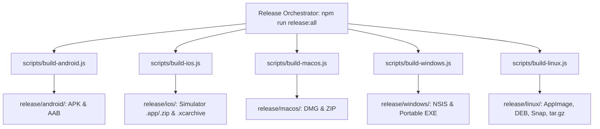

# IndiChat — System Architecture & Data Flow

## 1. System Overview

IndiChat is engineered as a high-performance, modular monolith supporting multi-platform real-time chat, rich media exchange, WebRTC audio/video call signaling, and multi-device session management across Web, Mobile, Desktop, and Backend.

```
+---------------------------------------------------------------------------------------------------------+
|                                               Client Tier                                               |
|  +---------------------------+  +-------------------------------------+  +----------------------------+ |
|  |    React 18/19 Web Client |  |     React Native / Expo Mobile      |  | Electron 33+ Desktop Client| |
|  |  (Vite + TS + CSS Tokens) |  |   (Expo Router v4, Android & iOS)   |  |   (macOS, Windows, Linux)  | |
|  +---------------------------+  +-------------------------------------+  +----------------------------+ |
+---------------------------------------------------------------------------------------------------------+
                    | REST APIs (HTTP/HTTPS)                          | WebSocket (WS/WSS)
                    v                                                 v
+---------------------------------------------------------------------------------------------------------+
|                                         Spring Boot 3.4 Gateway                                         |
|  - Security & Authentication (BCrypt, JWT Access/Refresh token rotation, WebAuthn Passkeys)            |
|  - Users, Contacts & Social Graph                                                                       |
|  - Conversations & Keyset Pagination Message History                                                    |
|  - Real-Time WebSocket Duplex Engine (ChatWebSocketHandler)                                             |
|  - Delivery & Read Receipts Engine (✓ Sent, ✓✓ Delivered, ✓✓ Read Blue)                                  |
|  - MinIO S3 Storage Adapter (multipart upload, streaming downloads, UUID hashing)                       |
|  - WebRTC Call Signaling Relay (offers, answers, ICE candidates, glare resolution)                      |
|  - Remote Device Revocation Engine (instant socket disconnect with code 4001)                           |
+---------------------------------------------------------------------------------------------------------+
            |                                       |                                    |
            v                                       v                                    v
+-----------------------+               +-----------------------+            +-----------------------+
|     PostgreSQL 16     |               |        Redis 7        |            |      MinIO / S3       |
|     (Port: 5554)      |               |     (Port: 6379)      |            |   (Port: 9000/9001)   |
| - Users & Credentials |               | - Online Presence     |            | - Photos & Media      |
| - Conversations       |               | - Last Seen Cache     |            | - Voice Notes         |
| - Messages & Stars    |               | - Typing States       |            | - Documents & Files   |
| - Delivery Receipts   |               | - Distributed Pub/Sub |            | - Attachments Bucket  |
| - Linked Devices      |               | - Heartbeat Monitor   |            +-----------------------+
| - Passkeys & 2FA      |               +-----------------------+
| - Call Logs (V1-V10)  |
| - Communities/Stories |
+-----------------------+
```

---

## 2. Real-Time Messaging & Receipts Engine

IndiChat implements strict message delivery and receipt lifecycles matching WhatsApp standards:

```
[Sender Client]                    [Spring Boot Backend]                 [Recipient Client]
       |                                     |                                   |
       |--- 1. message.send ---------------->|                                   |
       |    (conversationId, clientMsgId,..) |                                   |
       |                                     |--- 2. Write to PostgreSQL         |
       |                                     |    (status: SENT)                 |
       |<-- 3. message.created --------------|                                   |
       |    (Single Check ✓)                 |--- 4. message.created ----------->|
       |                                     |       (if recipient online)       |
       |                                     |                                   |
       |                                     |<-- 5. message.delivered ----------|
       |                                     |    (Write deliveredAt to DB)      |
       |<-- 6. message.receipt.updated ------|                                   |
       |    (Double Check ✓✓)                |                                   |
       |                                     |                                   |
       |                                     |<-- 7. message.read ---------------|
       |                                     |    (Write readAt to DB)           |
       |<-- 8. message.receipt.updated ------|                                   |
       |    (Double Blue Check ✓✓)           |                                   |
```

### Offline Reconciliation Mechanism
When a recipient is offline at the moment a message is sent:
1. The message is stored in PostgreSQL with no `delivered_at` timestamp.
2. The sender sees a single checkmark `✓`.
3. When the recipient reconnects and establishes a WebSocket handshake, `ChatWebSocketHandler.afterConnectionEstablished()` invokes `messageService.markAllPendingDeliveredForUser(recipientId)`.
4. All pending messages are marked delivered in PostgreSQL in a single batch.
5. The backend dispatches `message.receipt.updated` frames to all senders, updating their UI from single check `✓` to double check `✓✓` immediately.

---

## 3. Media & Object Storage Pipeline

IndiChat supports images, videos, audio notes, stickers, and documents:

1. **Upload Initiation**:
   - **Web**: Standard HTML file input attaches file to a `FormData` payload and posts to `/api/v1/files/upload`.
   - **Mobile (React Native)**: Native file upload via `expo-file-system` (`uploadAsync` or `ExpoFile`) avoids React Native Android binary upload corruption (`Unsupported FormDataPart implementation`).
   - **Desktop (Electron)**: Direct upload via local renderer through the embedded proxy.
2. **Storage Processing**:
   - Spring Boot receives multipart file.
   - Computes unique file UUID and stores binary into MinIO S3 bucket `chat-attachments`.
   - Returns metadata: `fileId`, `fileName`, `fileType`, `mimeType`, `fileSize`, `fileUrl`.
3. **Distribution**:
   - Sender transmits a chat message with `messageType: IMAGE | VIDEO | AUDIO | DOCUMENT | STICKER` containing the file URL.
   - Recipient renders inline preview or streams media via `/api/v1/files/download/{fileId}/{fileName}`.

---

## 4. Multi-Device Sessions & Remote Revocation

Users can link multiple browser instances, mobile phones, or desktop apps:

1. **Device Identification**:
   - Each client generates a persistent UUID stored in `localStorage` or `AsyncStorage`.
   - Sent via `X-Device-Id` HTTP header and WebSocket query param `?deviceId=...`.
2. **Session Inspection**:
   - Users view active devices under **Settings -> Linked Devices** (`GET /api/v1/devices`).
3. **Instant Remote Revocation**:
   - When a user deletes a device or triggers "Log out from all other devices":
   - The record is purged from `user_linked_devices`.
   - `ChatWebSocketHandler.disconnectDevice()` finds the active WebSocket session for that device ID.
   - Emits a `{ "type": "DEVICE_REMOVED", "payload": { "reason": "..." } }` frame.
   - Immediately closes the WebSocket connection with status code `4001`.
   - The revoked device catches the event and immediately resets to the login view.

---

## 5. WebRTC Audio & Video Calling Architecture

IndiChat supports cross-platform, peer-to-peer 1-to-1 audio and video calling across Web, Mobile, and Desktop clients:

- **Signaling Coordination**: WebRTC peer connections exchange SDP offers, SDP answers, and trickle ICE candidates through the backend via WebSocket type `call.signal`.
- **Session Correlation**: All signals carry a `callSessionId` preventing crosstalk across rapid consecutive calls, stale candidate injection, or race conditions.
- **Deterministic Glare Resolution**: When simultaneous offers are sent between peers, lexicographical comparison of normalized sender user IDs breaks the tie cleanly (the lower UUID yields and answers the higher UUID's incoming offer without dropping resources).
- **Native Android Audio Routing**: An in-tree Kotlin module (`AudioRouteModule.kt`) coordinates Android `AudioManager`, manages `MODE_IN_COMMUNICATION`, requests `AUDIOFOCUS_GAIN_TRANSIENT_EXCLUSIVE` for `USAGE_VOICE_COMMUNICATION`, handles earpiece/speakerphone toggling via `setCommunicationDevice()` (API 31+) / legacy fallbacks, and cleanly releases audio focus and modes on call teardown.
- **In-Call Controls**: Real-time microphone mute, camera disable/preview hide, front/back camera flipping via `track._switchCamera()`, and speakerphone switching.
- **Call Termination & Reasons**: Dedicated termination reasons (`user_ended`, `user_declined`, `user_busy`, `caller_cancelled`, `unanswered`) propagate through signaling hangups and immediately unmount UI overlays.
- **Local Call Logging & In-Chat Bubbles**: Call start, duration, direction, and completion are logged in persistent local storage and rendered as dedicated call status bubbles inside the chat thread.

---

## 6. Local Archive Export & Read-Only Viewer

IndiChat provides a local privacy-preserving backup mechanism:
- **Export**: Exports conversations and plaintext messages via `GET /api/v1/conversations/backup`, streamed and written locally to disk without remote attachment bloat.
- **Read-Only Local Archive Viewer**: Modal interface (`LocalArchiveViewerModal.tsx`) strictly parses, validates format/version, and enforces safety limits (10 MB file size, 1,000 conversations, 50,000 messages, 10,000 characters per message).
- **Untrusted Safety Architecture**: Imported archives are treated as unauthenticated, editable plaintext. The viewer never executes content, never auto-fetches remote attachments, and strictly never mutates or restores messages into live server conversations.

---

## 7. Multi-Platform Packaging & Build Engines

IndiChat features a comprehensive, zero-configuration build engine architecture supporting all target operating systems:



### A. Android Build Pipeline (`scripts/build-android.js`)
- Auto-detects `ANDROID_HOME` & JDK 17/21.
- Verifies and grants Gradle execution permissions.
- Runs `:app:assembleRelease` or `:app:bundleRelease` with `--no-daemon`.
- Collects outputs into `release/android/IndiChat.apk` and `IndiChat.aab`.

### B. iOS Build Pipeline (`scripts/build-ios.js`)
- Validates Xcode toolchain (`xcodebuild`) and CocoaPods environment.
- Prebuilds native iOS workspace with React Native New Architecture.
- Syncs high-resolution AppIcon assets (`logo/ios/AppIcon.appiconset`).
- Compiles iOS Simulator `.app` & `.zip` bundles (no signing needed) or `.xcarchive` device builds into `release/ios/`.

### C. Desktop Build Pipelines (macOS, Windows, Linux)
- **macOS** (`scripts/build-macos.js`): Packages Electron app into native arm64/x64 DMG and ZIP distributions into `release/macos/`.
- **Windows** (`scripts/build-windows.js`): Packages NSIS installer and standalone portable EXE into `release/windows/` with PE header integrity verification.
- **Linux** (`scripts/build-linux.js`): Packages universal AppImage, Debian `.deb`, Canonical Snap, and portable `.tar.gz` into `release/linux/`, accompanied by Freedesktop `.desktop` and AppStream metadata.

### D. Universal Release Runner (`scripts/build-all-releases.cjs`)
- Executes all 5 platform pipelines sequentially.
- Guarantees fresh artifact generation and emits a structured run manifest in `release/build-all/<run-id>/summary.json`.
- Supports `--dry-run` (`npm run release:plan`) and selective platform targeting (`--platforms=macos,linux`).

### E. Project-Local Build Toolchain Caching (`build_run_package/`)
- Toolchain binaries, Wine runners, and Electron packaging runtimes are cached in `build_run_package/` via `scripts/setup-build-packages.js`.
- Enables reproducible packaging without relying on ad-hoc global caches or network latency during builds.

---

## 8. Interactive Design Previews & Visual Verification (`preview/`)

IndiChat includes an interactive design preview engine (`preview/`) for automated visual verification and cross-platform fidelity checking:
- **Zero-Dependency Preview Server**: Serves design tokens, smartphone chrome frames, and responsive chat layouts.
- **Viewport Emulation**: Automated verification of mobile (iOS & Android aspect ratios), tablet, and desktop viewports.
- **Visual Regression Defense**: Automated CDP capture scripts (`scripts/capture_preview_cdp.mjs`, `scripts/capture-parity-comparisons.cjs`) generate pixel-exact comparisons ensuring no layout or contrast regressions occur during development.
