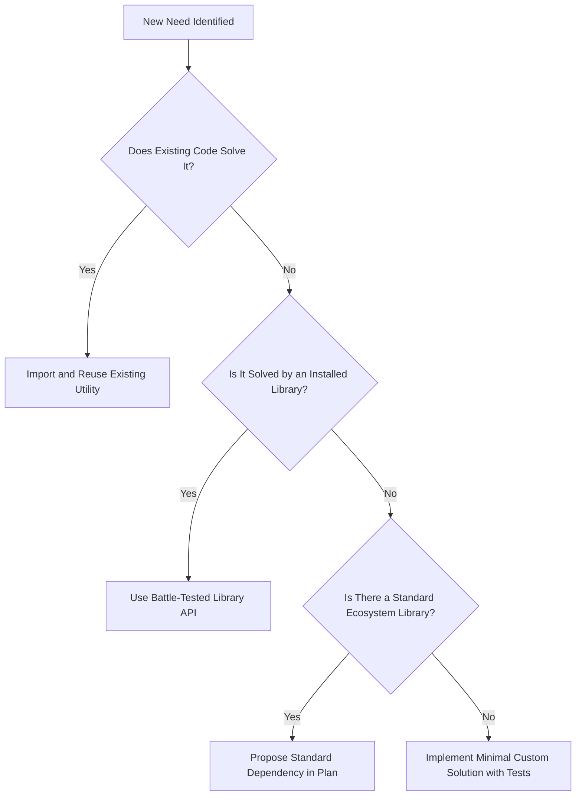

# Phase 1 & 2: Discovery, Codebase Inspection & Requirements Engineering

> **Engineering Standard: Grounded Discovery & Crisp Requirements**  
> Never write a single line of production code on assumption. This guide details how to inspect unfamiliar repositories, uncover technical constraints, clarify ambiguous requirements, and craft testable acceptance criteria.

---

## 1. Grounded Codebase Discovery Methodology

When an agent or engineer approaches a project or new task, they must establish ground truth before formulating plans.

### A. Pre-Flight Inspection Checklist
Run these commands or inspections in sequence:

1. **Git Repository State**:
   ```bash
   git status -s
   git branch -v
   git log -n 5 --oneline
   ```
   *Objective*: Verify whether uncommitted changes exist, check current branch, and inspect recent commit conventions.

2. **Technology Stack Detection**:
   Inspect the root directory and child folders for package manifests to determine the stack:
   * Node.js / TypeScript: `package.json`, `pnpm-workspace.yaml`, `lerna.json`, `tsconfig.json`
   * Java / Kotlin: `pom.xml`, `build.gradle`, `build.gradle.kts`, `settings.gradle`
   * Python: `pyproject.toml`, `requirements.txt`, `Pipfile`, `setup.py`
   * Go: `go.mod`, `go.sum`
   * Rust: `Cargo.toml`, `Cargo.lock`
   * .NET / C#: `*.sln`, `*.csproj`
   * Mobile: `app.json`, `AndroidManifest.xml`, `Podfile`, `metro.config.js`
   * Containers: `docker-compose.yml`, `Dockerfile`

3. **Active Ports & Service Mapping**:
   Locate port allocations and environment variables to avoid port collisions:
   * Inspect `docker-compose.yml`, `.env.example`, `application.yml`, `vite.config.ts`.
   * Note down external service endpoints (PostgreSQL, Redis, MinIO/S3, Kafka, RabbitMQ).

4. **Instructions & Conventions Audit**:
   * Inspect agent instruction files: `AGENTS.md`, `CLAUDE.md`, `GEMINI.md`.
   * Inspect existing architecture documentation: `docs/architecture.md`, `docs/api-contracts.md`.

---

## 2. Code Search & Reuse First (Anti-Reinvention Standard)

Before proposing any utility, custom serializer, HTTP helper, or complex algorithm, search the repository and established libraries:



### Discovery Command Reference:
* Ripgrep pattern search: `rg -n "export const useAuth" .` or search tool
* Find file by glob: `find . -maxdepth 3 -name "*Receipt*"`
* Inspect shared contracts: Always inspect [packages/shared-types/src/index.ts](../../packages/shared-types/src/index.ts) before creating local frontend/backend models.

---

## 3. Requirements Clarification Protocol

Requirements provided by users, product managers, or issue tickets often contain ambiguities or unstated assumptions.

### A. The 3-Question Rule
When requirements are ambiguous, do not overwhelm the user with a 10-point questionnaire. Ask **at most 1 to 3 targeted, structured questions**, formatted with clear options and a recommended default:

```markdown
To ensure the implementation aligns with your expectations, please clarify:

1. **Message Retention Behavior**:
   - (Recommended) Keep deleted messages marked with `is_deleted = true` (tombstone) to sync deletion across devices.
   - Hard-delete message records immediately from PostgreSQL.

2. **Offline Queuing Behavior**:
   - (Recommended) Queue unsent messages in client IndexedDB/AsyncStorage and auto-retry on reconnect.
   - Display a send error immediately without offline queuing.
```

### B. Non-Functional Requirements (NFR) Checklist
Always evaluate whether the feature imposes specific non-functional constraints:
* **Latency Budget**: Is real-time delivery required (< 200ms) or is polling acceptable?
* **Concurrency & Race Conditions**: Can multiple devices update this entity simultaneously?
* **Data Volume & Pagination**: Will this list grow to thousands of items? Require cursor-based or offset pagination?
* **Security & Auth**: Which roles/users are permitted to invoke this? Are JWT tokens validated on every WebSocket frame?
* **Backwards Compatibility**: Will old mobile clients crash if a new field is added to the API payload?

---

## 4. Writing Crisp Acceptance Criteria

Acceptance criteria transform business intent into verifiable engineering targets. Structure all acceptance criteria using the **Given-When-Then (Gherkin)** pattern or bulleted verifiable invariants.

### Example: Typing Indicator in Chat Room

```gherkin
Scenario: User starts typing in a direct conversation
  Given Alice is authenticated and connected to WebSocket
  And Alice and Bob share conversation "conv-123"
  When Alice types characters into the message input field
  Then client sends WebSocket event 'user.typing' with payload { conversationId: "conv-123", isTyping: true }
  And backend broadcasts 'user.typing' only to Bob (not Alice)
  And Bob's UI displays "Alice is typing..." indicator

Scenario: Typing indicator auto-expires after inactivity
  Given Bob is viewing "Alice is typing..." for conversation "conv-123"
  When 3000ms elapse without receiving another typing event
  Then Bob's UI automatically hides the "Alice is typing..." indicator
```

### Invariant Checklist
In addition to user stories, list non-negotiable system invariants:
- [ ] Invariant 1: Typing events must never be persisted to PostgreSQL or disk.
- [ ] Invariant 2: Rate limit typing events to at most 1 event per 1500ms per user to prevent WebSocket flooding.
- [ ] Invariant 3: Typing status must immediately clear upon message send.

---

## 5. Identifying Constraints & Edge Cases

Document edge cases during Phase 2 before designing components:

| Category | Potential Trap | Preventive Design Strategy |
|---|---|---|
| **Network & Connectivity** | WebSocket drops mid-transfer | Client keeps message in `sending` state; retries with same `clientMsgId` upon reconnect to guarantee idempotency. |
| **Multi-Device Sync** | User has Web and Mobile active | Server fans out outgoing/incoming events to all active device sessions belonging to the user. |
| **Null & Undefined States** | Optional profile picture or bio | Frontend components must handle `null` gracefully; render initials avatar fallback. |
| **Race Conditions** | Two users react to message simultaneously | Database uses optimistic locking or atomic upsert on reactions table. |
| **Oversized Payloads** | User uploads 50MB file to chat | Backend rejects file at HTTP gateway (Spring `MaxUploadSizeExceededException`); frontend validates file size before upload. |

---

## 6. Verified ECC Tools for Phase 1 & 2

* **Agent `spec-miner`**: Parses codebase files, logs, and issues to extract latent specifications.
* **Agent `planner`**: Structures discovery into actionable phases.
* **Skill `skills/codebase-onboarding`**: Generates architecture maps and entry point catalogs.
* **Skill `skills/product-lens`**: Validates problem statements and challenges premature implementation.
* **Workflow `workflows/aside.md`**: Asks quick clarification questions without losing task context.
