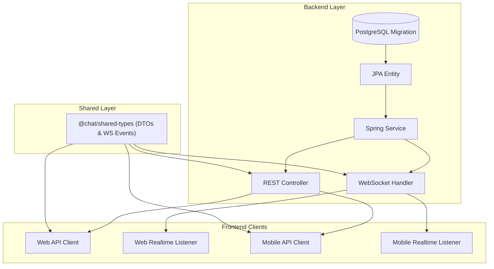

# Phase 4, 5 & 6: Architecture Review, System Design & Implementation Planning

> **Engineering Standard: Robust Design Before Code**  
> Writing code without an architecture plan leads to regressions, inconsistent API contracts, breaking schema changes, and high technical debt. This guide establishes the standard for architectural impact analysis, data modeling, API contract governance, and the Phase 6 Plan Approval Gate.

---

## 1. Architectural Impact & Blast Radius Analysis

Before modifying any file, conduct a blast radius analysis across the stack:



### Blast Radius Assessment Checklist

* **Contract Propagation**: Does this change require updating [packages/shared-types/src/index.ts](../../packages/shared-types/src/index.ts)?
* **Persistence & Schema**: Does this change require altering database columns, indexes, or relations?
* **Realtime Routing**: Does this change introduce a new WebSocket event type or payload structure?
* **Multi-Platform Impact**: Will both Web (`apps/web`) and Mobile (`apps/mobile`) require UI and store updates?
* **Caching & State**: Does this affect Redis cache keys, TTLs, or session presence?

---

## 2. Data Modeling & Schema Evolution Rules

When adding or altering persistence models, follow these non-negotiable database rules:

### A. The Append-Only Migration Invariant

1. **Never edit an existing migration file**: Flyway validates SQL checksums on startup. Editing an already applied migration (e.g. `V1__...`, `V2__...`) causes a fatal `FlywayException` on application boot.
2. **Always create a new sequence**: Add `backend/src/main/resources/db/migration/V<N>__<descriptive_name>.sql`.
3. **Use Safe PostgreSQL Dialect**:
   * Always use `TIMESTAMPTZ` for timestamps (e.g., `created_at TIMESTAMPTZ DEFAULT CURRENT_TIMESTAMP NOT NULL`).
   * Use `UUID` with `gen_random_uuid()` for primary keys.
   * Add explicit foreign key constraints with indexed columns to avoid full table scans.

### B. Backward-Compatible Schema Changes & Indexing Mechanics

When modifying existing tables in production:

* **Adding a Column**: Must have a safe `DEFAULT` or allow `NULL`. Never add a `NOT NULL` column without a default value to an existing populated table.
  * *Deployment-Impact Assessment (Do Not Assume Zero Downtime)*: Avoid claiming zero downtime merely because a column is nullable or has a default. In PostgreSQL 11+, adding a column with a constant default is metadata-only, but adding volatile defaults (e.g., non-immutable function calls like `clock_timestamp()`) forces a full table rewrite. Furthermore, `ALTER TABLE` requires an `ACCESS EXCLUSIVE` lock briefly: under high traffic, waiting for this lock can queue all incoming queries and saturate connection pools unless protected by a short `lock_timeout`. Always perform a migration and deployment-impact assessment.
* **Renaming a Column**: Use the Expand-Contract pattern (Add new column -> Dual-write -> Backfill -> Read from new -> Drop old in future release).
* **Index Strategy & PostgreSQL Transaction Rules**:
  * **Transactional `CREATE INDEX` (Default & Preferred for Small/New Tables)**: Standard index creation executes within a transaction. It is atomic and rolls back cleanly on error. Use this as the default for new tables, smaller tables, staging environments, and maintenance windows unless concurrent indexing is explicitly justified.
  * **Non-Transactional `CREATE INDEX CONCURRENTLY` (Large Active Production Tables)**:
    * Avoids acquiring an `ACCESS EXCLUSIVE` table lock that would block concurrent reads and writes on high-volume production tables.
    * **PostgreSQL Invariant**: `CREATE INDEX CONCURRENTLY` **cannot execute inside a PostgreSQL transaction block** (`ERROR: CREATE INDEX CONCURRENTLY cannot run inside a transaction block`).
    * **Flyway Community Configuration**: The backend uses Flyway Community Edition 10.x. Per-migration script configuration files (`<filename>.sql.conf`) with `executeInTransaction=false` are supported in Flyway Community Edition. When applied (e.g. `V5__add_messages_idx.sql.conf` alongside `V5__add_messages_idx.sql`), Flyway does not wrap the script in `BEGIN ... COMMIT`, allowing PostgreSQL to execute `CREATE INDEX CONCURRENTLY`.
    * **Failure Recovery & INVALID Indexes**: Because execution is non-transactional, an interrupted or failed concurrent index build leaves behind an `INVALID` index that consumes disk space and write overhead without serving queries. It must be manually dropped via `DROP INDEX CONCURRENTLY IF EXISTS <index_name>;` and the Flyway schema history repaired before retrying (note that bare `mvn flyway:repair` fails in this project because datasource properties reside in `application.yml`; run with verified connection flags for local development: `mvn flyway:repair -Dflyway.url=jdbc:postgresql://localhost:5554/chat_platform -Dflyway.user=postgres -Dflyway.password=postgres`; in staging and production environments, substitute the target environment's actual database URL and inject credentials securely via environment variables or secret stores rather than default development values). Do not manually delete records from `flyway_schema_history` as a routine procedure, as manual table manipulation risks corrupting checksum tracking and schema state.
    * **Alternative Out-of-Band DBA Practice**: In enterprise production databases, DBAs often create concurrent indexes out-of-band directly in PostgreSQL during off-peak windows, followed by recording a baseline or metadata migration in Flyway to avoid holding deployment runners open during long index builds.
* **Distinction: Rollback vs. Recovery vs. Restoration**:
  * *Schema Rollback*: In tools without automatic down-migrations (e.g., Flyway Community), rollback is achieved by applying a forward corrective migration (`V<N+1>__revert_...sql`).
  * *Roll-Forward Recovery*: Deploying a fast-follow fix migration that maintains dual application compatibility.
  * *Data Restoration*: Point-in-time recovery (PITR) or physical backup restoration (e.g., `pg_restore`), which is strictly distinct from schema migration management.

---

## 3. API Contract & Protocol Design Standard

Modern architectures separate request-response state changes (REST) from real-time duplex streaming (WebSockets).

### A. REST API Standards

* **Base Path**: `/api/v1/...`
* **JSON Serialization**: CamelCase keys in JSON bodies matching TypeScript contracts.
* **HTTP Status Codes**:
  * `200 OK`: Successful read or update with response body.
  * `201 Created`: Entity successfully created.
  * `204 No Content`: Successful deletion or command without payload.
  * `400 Bad Request`: Input validation failed (returns RFC-7807 problem details or `{ error, message }`).
  * `401 Unauthorized`: Missing or invalid access token.
  * `403 Forbidden`: Authenticated user lacks permission to access resource.
  * `404 Not Found`: Resource does not exist.
  * `409 Conflict`: Unique constraint violation or state conflict.

### B. WebSocket Authentication & Protocol Standards

#### 1. WebSocket Authentication Architecture

Avoid recommending long-lived access tokens in WebSocket URLs (`/ws?token=<JWT>`) by default:

* **The URL Query Parameter Risk**: URLs and query strings appear in plain text across HTTP reverse proxy logs (Nginx, Envoy), application server access logs (Tomcat, Jetty), browser history, and APM/telemetry traces. Exposing a long-lived JWT in a query parameter creates a severe token leakage and session hijacking risk.
* **Preferred Secure Approaches**:
  1. **HTTP-Only, Secure SameSite Cookies**: For browser clients, rely on the HTTP upgrade handshake request automatically transmitting secure, HTTP-only session cookies.
  2. **Short-Lived, Single-Use Connection Tickets**: The client performs an authenticated REST call (`POST /api/v1/auth/ws-ticket` using standard `Authorization: Bearer` or cookie) to acquire a single-use cryptographically random ticket valid for 30–60 seconds stored in Redis. The client connects via `/ws?ticket=<ticket>`, and the server validates and immediately deletes/burns the ticket upon connection. Leaked tickets in logs are already expired and useless.
  3. **Handshake HTTP Headers**: For native mobile (React Native / Android / iOS) and desktop (Electron) clients where custom headers are supported by the WebSocket client library, pass credentials via standard handshake headers: `Authorization: Bearer <token>` and `X-Device-Id: <id>`.
* **If Query Parameters Are Unavoidable (Legacy / Simple Browser Fallbacks)**:
  * Minimize the token lifetime and restrict its scope strictly to WebSocket connection.
  * Ensure reverse proxies, API gateways, and web servers configure access log redaction/masking to scrub query strings or the `token=` parameter (e.g. logging `$uri` instead of `$request_uri`).

#### 2. Connection Authentication vs. Operation Authorization

* **Connection Authentication**: Occurs during the initial HTTP upgrade handshake. The server extracts credentials, verifies token validity and device status, and terminates unauthorized connections with `POLICY_VIOLATION` (4003) or `4001` (Session Revoked).
* **Operation Authorization**: Every incoming duplex frame (e.g., sending a message, reacting, typing) must verify that the authenticated session user is an active, authorized member of the target conversation before processing or fanning out data.

#### 3. Envelope Format

Every WebSocket frame must conform to a unified event envelope:

```typescript
export interface WebSocketEvent<T = any> {
  type: WebSocketEventType; // e.g. "message.send", "message.created", "presence.updated"
  payload: T;
  timestamp: string; // ISO-8601
}
```

* **Event Naming Conventions**:
  * Client to Server commands: `domain.action` (e.g., `message.send`, `message.delivered`, `user.typing`)
  * Server to Client events: `domain.state` or `domain.action` (e.g., `message.created`, `message.receipt.updated`, `presence.updated`)

---

## 4. File-Level Change Plan Structure

Every implementation plan must detail the exact files to be created, modified, or removed:

### Example Plan Matrix:

| Step | Target File | Action | Purpose & Scope of Modification |
|---|---|---|---|
| **1** | `packages/shared-types/src/index.ts` | Edit | Export `PinnedMessageDTO` and `message.pinned` WebSocket event payload. |
| **2** | `backend/.../db/migration/V6__pinned_messages.sql` | Create | Add `pinned_at` column and index to `messages` table. |
| **3** | `backend/.../message/MessageEntity.java` | Edit | Add `@Column(name = "pinned_at") private Instant pinnedAt;` field. |
| **4** | `backend/.../message/MessageService.java` | Edit | Implement `pinMessage(UUID conversationId, UUID messageId, UUID userId)`. |
| **5** | `backend/.../message/MessageController.java` | Edit | Expose `POST /api/v1/conversations/{id}/messages/{msgId}/pin`. |
| **6** | `backend/.../websocket/ChatWebSocketHandler.java` | Edit | Broadcast `message.pinned` event to conversation members. |
| **7** | `apps/web/src/features/chats/ChatWindow.tsx` | Edit | Render pinned message banner at top of chat pane. |
| **8** | `apps/mobile/app/chat/[id].tsx` | Edit | Render pinned message bar with quick-scroll action. |

---

## 5. Risk Assessment & Mitigation Matrix

Identify what could go wrong before executing:

| Identified Risk | Severity | Probability | Mitigation Strategy |
|---|---|---|---|
| **Mobile LAN routing failure** | High | Medium | Keep fallback to `Constants.expoConfig?.hostUri` in `apps/mobile/services/api.ts`. |
| **WebSocket message duplication** | Medium | High | Enforce `clientMsgId` uniqueness check on backend message ingestion. |
| **Database lock on large table** | Critical | Low | Ensure index creation does not lock table during production deployment. |
| **Out-of-sync local package links** | Medium | Medium | Run `npm install` from root to restore workspace symlinks. |

---

## 6. Phase 6: Plan Review & Approval Gate

The Plan Approval Gate is a mandatory pause point before modifying production code.

### When Approval is Strictly Required:
1. Architectural changes involving database migrations or schema alterations.
2. Changes to authentication, session management, or encryption.
3. Breaking changes to public REST or WebSocket API contracts.
4. Adding new external dependencies or libraries.
5. Deleting or refactoring existing shared components used across multiple apps.

### Approval Presentation Standard:
Present the plan clearly to the user:
```markdown
### Implementation Plan Summary for [FEATURE_NAME]
- **Files Modified**: [N files across Shared Types, Backend, Web, Mobile]
- **Database Migrations**: [V<N>__<name>.sql - Assessed for locking, backfills, and backward compatibility]
- **Contract Changes**: [Non-breaking, adds optional field]
- **Key Risks & Mitigations**: [Documented above]

May I proceed with implementing this plan, starting with Phase 7 (TDD tests)?
```
*Wait for user confirmation before advancing to Phase 7 or 8.*

---

## 7. Verified ECC Tools for Phase 4 & 5

* **Agent `architect`**: System design review and blast radius analysis.
* **Agent `planner` / `gan-planner`**: Granular file sequencing and task breakdown.
* **Skill `skills/architecture-decision-records`**: Formats ADRs for architectural pivot points.
* **Workflow `workflows/plan.md`**: Core implementation planning workflow.
* **Workflow `workflows/prp-plan.md`**: Deep feature planning with codebase pattern extraction.
