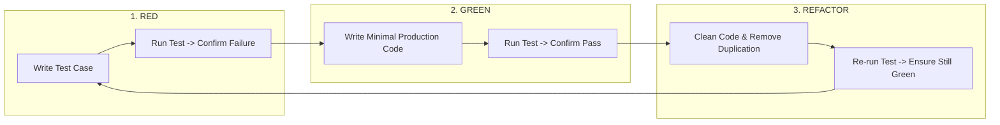
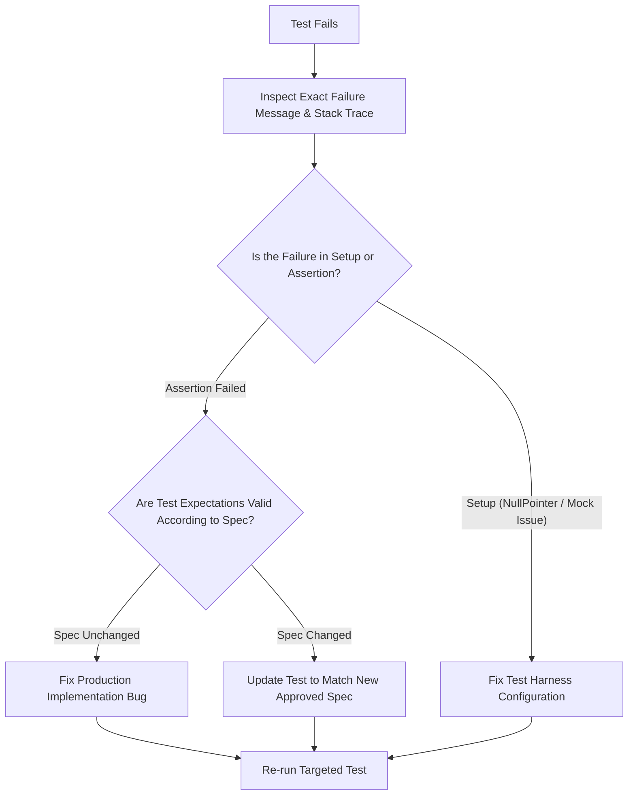

# Phase 7 & 9: Testing Strategy, TDD & Quality Assurance

> **Engineering Standard: Test-Driven Quality & Risk-Based Assurance**  
> Code without automated tests is legacy code the moment it is committed. This document defines the testing pyramid, Test-Driven Development (TDD) workflow, the Arrange-Act-Assert (AAA) pattern, failure diagnosis, and stack-specific test execution.

---

## 1. The Testing Pyramid & Test Levels

Maintain a balanced distribution of automated tests across all tiers of the system:

```
           / \
          /   \     E2E / UI Tests (5–10%)
         / E2E \    Cross-platform user flows, WebSocket delivery end-to-end
        /-------\
       /         \    Integration & API Tests (20–30%)
      / Integrat. \   REST controllers, JPA queries, Redis presence, MinIO
     /-------------\
    /               \   Unit Tests (60–70%)
   /   Unit Tests    \  Domain logic, token validation, date helpers, state hooks
  /-------------------\
```

### Definitions & Scope:
1. **Unit Tests**: Test pure business logic, utilities, validation rules, and isolated functions. Fast (< 10ms each), zero network or database dependencies.
2. **Integration Tests**: Verify collaboration between multiple components (e.g., Spring Service + JPA Repository with in-memory H2 or Testcontainers, React Context + hooks).
3. **API & Contract Tests**: Validate REST HTTP endpoints and WebSocket frame routing against shared TypeScript contracts.
4. **End-to-End (E2E) & UI Tests**: Verify critical user journeys (Login -> Send Message -> Receive Tick -> Logout) across browser or mobile emulators.
5. **Regression Tests**: Tests written specifically to reproduce and permanently safeguard against resolved bugs.

---

## 2. Test-Driven Development (TDD) Workflow

Follow the mandatory three-phase TDD loop:



### Strict TDD Invariants

* **Never write implementation code before a failing test exists** (when practicing TDD).
* Verify that the test fails for the *expected reason* (e.g. assertion failure or missing method, NOT an unrelated syntax error in another package).
* Write only enough production code to turn the test green.
* **Practical Coverage Standards**: Prioritize automated test coverage for meaningful business logic, state machines, financial/security boundaries, and regression risks. Use coverage metrics (such as 80%+ on core domain services) as a quality guide rather than a dogmatic quota that produces brittle tests on trivial getters, UI boilerplate, or framework plumbing.

---

## 3. Test Structure: The AAA Pattern

Structure every test clearly using **Arrange, Act, Assert**:

```typescript
// Arrange: Set up inputs, mocks, and initial state
const user = createMockUser({ id: 'usr-1', name: 'Alice' });
const initialPresenceState = { isOnline: false, lastSeen: null };
const presenceService = new PresenceService();

// Act: Execute the unit under test
const updatedState = presenceService.markUserOnline(user.id);

// Assert: Verify state transitions and return values
expect(updatedState.isOnline).toBe(true);
expect(updatedState.lastSeen).toBeDefined();
```

### Test Naming Standard

Name tests using descriptive behavioral statements that explain what happens when conditions are met:

* `should_return_delivered_receipt_when_recipient_device_is_connected`
* `should_throw_unauthorized_exception_when_jwt_signature_is_invalid`
* `should_auto_retry_upload_when_s3_connection_times_out`
* `should_render_double_blue_ticks_when_message_status_is_read`

---

## 4. Stack-Specific Test Execution Reference

*(See [PROJECT_CONTEXT.md](./PROJECT_CONTEXT.md) for this workspace's verified testing commands; adapt for other stacks as needed).*

### A. Java 21 & Spring Boot 3.3.5 (`backend/`)
* **Frameworks**: JUnit 5, Mockito, Spring Security Test, AssertJ.
* **Database**: In-memory H2 database (`src/test/resources/application-test.yml`) or Testcontainers PostgreSQL.
* **Execution Commands**:
  ```bash
  # Run all unit and integration tests (verified)
  cd backend && mvn test

  # Run a single targeted test class
  mvn test -Dtest=MessageServiceTest

  # Run a specific test method
  mvn test -Dtest=MessageServiceTest#testPinMessageSuccess

  # Dockerized test execution (matches monorepo root script)
  npm run backend:test
  ```

### B. React 18.3 Web Client (`apps/web/`)
*(Note: A test runner script such as Vitest is not pre-configured in `apps/web/package.json`; commands below reflect standard ecosystem practice when a test runner is configured).*
* **Frameworks**: Vitest / Jest, React Testing Library, User Event.
* **Execution Commands**:
  ```bash
  cd apps/web
  # Run tests in watch mode (requires test runner script)
  npm test

  # Run single test run with coverage
  npx vitest run --coverage

  # Run targeted test file
  npx vitest run src/features/chats/ChatWindow.test.tsx
  ```

### C. React Native & Expo Mobile Client (`apps/mobile/`)
*(Note: A test runner script is not pre-configured in `apps/mobile/package.json`; commands below reflect standard ecosystem practice when a test runner is configured).*
* **Frameworks**: Jest, React Native Testing Library.
* **Execution Commands**:
  ```bash
  cd apps/mobile
  npm test

  # Run targeted test with mock native modules
  npm test -- app/chat/[id].test.tsx
  ```

---

## 5. Eliminating Flakiness & Mocking Guidelines

Flaky tests erode trust in CI/CD. Adhere to these anti-flakiness rules:

1. **Never use arbitrary `sleep()` or `setTimeout()` in tests**:
   * Use polling await assertions (e.g. `await waitFor(() => expect(...).toBeVisible())` or Awaitility in Java: `await().atMost(5, SECONDS).until(...)`).
2. **Deterministic Clocks**:
   * Mock system clocks using `jest.useFakeTimers()` or Java `Clock.fixed()`. Never assert on dynamic `System.currentTimeMillis()` without tolerance deltas.
3. **Avoid Over-Mocking**:
   * Mock external boundaries only (Network HTTP calls, Redis connection, S3 storage). Do not mock internal domain data structures, records, or DTOs.
4. **State Isolation**:
   * Ensure each test cleans up its database entries or in-memory stores (`@DirtiesContext`, `afterEach(() => resetStore())`). Tests must never depend on execution order.

---

## 6. Test Failure Diagnosis Protocol

When an automated test fails, follow this root cause analysis procedure:



* **Never delete a failing test** to make a build pass.
* **Never weaken assertions** (e.g., changing `expect(res.status).toBe(200)` to `expect(res.status).toBeDefined()`) to bypass a bug.

---

## 7. Verified ECC Tools for Phase 7 & 9

* **Agent `tdd-guide`**: Guides the Red-Green-Refactor loop and ensures tests are written before code.
* **Agent `pr-test-analyzer`**: Evaluates pull request test coverage and identifies untested edge cases.
* **Skill `skills/tdd-workflow`**: Comprehensive reference on unit, integration, and golden testing patterns.
* **Skill `skills/ai-regression-testing`**: Sandbox API testing and AI blind spot detection.
* **Workflow `workflows/react-test.md`**: Specialized React Testing Library workflows.
* **Workflow `workflows/test-coverage.md`**: Analyzes test coverage gaps and generates missing test cases.
