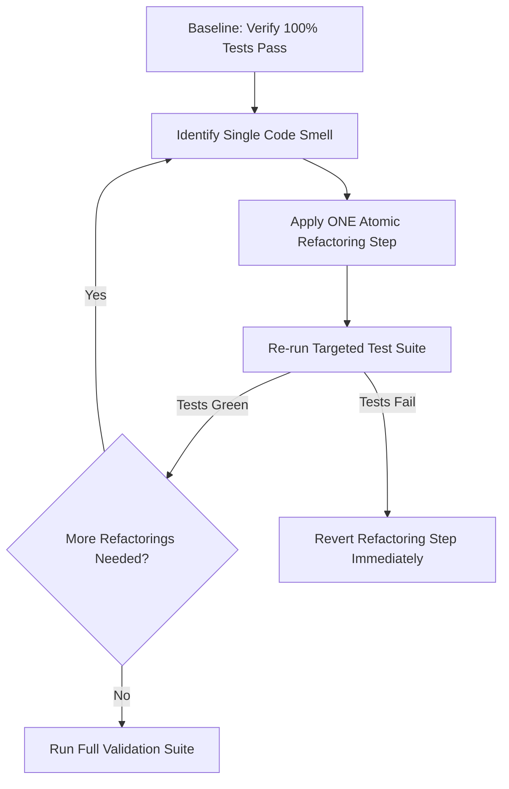

# Phase 10 & 11: Code Review Standards, Defect Detection & Safe Refactoring

> **Engineering Standard: Uncompromising Quality & Behavioral Equivalence**  
> Code review is the ultimate quality gate before software enters shared branches or staging environments. This guide details pre-review diff inspection, severity classification, automated defect detection, safe behavior-preserving refactoring, and dead code elimination.

---

## 1. Pre-Review Requirements & Diff Inspection

Before asking an agent or human peer to review code, conduct self-inspection:

### Self-Review Inspection Commands

Do not rely solely on `git diff HEAD`, because it only compares tracked modifications and completely ignores untracked files. Inspect all three Git states separately:

```bash
# 1. Inspect untracked files explicitly
git ls-files --others --exclude-standard

# 2. Inspect unstaged working-tree changes line-by-line
git diff

# 3. Inspect staged changes ready for commit
git diff --cached

# 4. Review combined tracked diff against baseline
git diff HEAD

# 5. Check change statistics and modified file list
git diff --stat
```

> **Git Safety Invariant**: Never run destructive commands that automatically discard or rewrite user changes (e.g., `git reset --hard`, `git checkout .`, `git clean -fd`, `git rebase -i`) without explicit, affirmative authorization from the human engineer.

### Clean Diff Checklist

- [ ] No temporary debugging statements (`console.log`, `System.out.println`, `debugger`).
- [ ] No hardcoded passwords, tokens, API keys, or internal staging URLs.
- [ ] No unintentional formatting or whitespace churn in unrelated files.
- [ ] No modified package lockfiles without explicit dependency additions.
- [ ] No committed `.env` files or temporary build artifacts (`dist/`, `target/`).

---

## 2. Review Severity Classification Matrix

Categorize every code review comment into standardized severity tiers:

| Severity Level | Definition | Impact on PR / Merge | Required Action |
|---|---|---|---|
| **CRITICAL** | Security vulnerability, data loss risk, auth bypass, severe memory leak, or broken public API. | **HARD BLOCK** | Must be fixed and re-verified immediately before any merge. |
| **HIGH** | Functional defect, uncaught exception, N+1 database query, broken edge case, or missing test. | **BLOCK** | Must be resolved before merge. |
| **MEDIUM** | Code duplication, high cognitive complexity / excessive nesting, suboptimal naming, missing docs. | **ADVISORY** | Resolve during current cycle or log tracked tech debt issue. |
| **LOW** | Minor stylistic inconsistency, optional syntax simplification, typo in comments. | **OPTIONAL** | Discretion of author. |

---

## 3. Automated Defect Detection Checklist

Audit the working diff specifically for these high-frequency defect patterns:

### A. Performance & Database Defect Patterns
* **N+1 Query Syndrome**: Iterating over a collection and executing an SQL query per item instead of using `JOIN FETCH` or batching (`findAllById`).
* **Missing Index on Foreign Keys**: Foreign key columns missing indexes, forcing sequential scans on table joins.
* **Unbounded Database Queries**: `SELECT * FROM messages` without a `LIMIT` clause or timestamp cursor.
* **Connection / Stream Leaks**: Missing `try-with-resources` on Java InputStreams or unclosed WebSocket connections.

### B. Concurrency & Asynchronous Defect Patterns
* **Floating Promises / Missing Awaits**: Calling an async function without `await` or `.catch()`, causing silent unhandled promise rejections.
* **Race Conditions in State Updates**: Calling React `setState(count + 1)` instead of functional updates `setState(c => c + 1)`.
* **Zombie Event Listeners**: Adding event listeners in React `useEffect` without returning a cleanup function.

### C. Type Safety & Logic Defects
* **Type Assertions as Escape Hatches**: Abuse of `as any` or `@SuppressWarnings("unchecked")` to silence legitimate compiler type errors.
* **Improper Equality Checks**: Comparing Java Strings using `==` instead of `.equals()`, or JavaScript objects with `===`.
* **Null Pointer Dereferences**: Accessing nested properties without optional chaining (`user?.profile?.avatarUrl`).

---

## 4. Safe Behavior-Preserving Refactoring Protocol

Refactoring is the process of restructuring existing code without altering its external behavior. Follow these strict rules:



### Safe Refactoring Rules:
1. **Never refactor and add new features simultaneously**: Separate feature development from structural cleanup in distinct commits.
2. **Preserve Public Signatures**: Do not change method names, parameter types, or return shapes of public APIs unless participating in a scheduled breaking deprecation.
3. **Atomic Steps**:
   * Step 1: Extract method / component.
   * Step 2: Run tests (confirm green).
   * Step 3: Rename variable for clarity.
   * Step 4: Run tests (confirm green).
   * Step 5: Inline redundant intermediary.
   * Step 6: Run tests (confirm green).

---

## 5. Dead Code Elimination Standards

Dead code degrades cognitive performance and increases maintenance burden.

* **Safe Removal**: If an unused function or component has 0 references in the monorepo, remove it entirely. Git history preserves the code if it is ever needed again.
* **Avoid Commented-Out Code**: Never commit blocks of commented-out code. Delete them.
* **Deprecation Notice for Shared Contracts**:
  If deprecating an export in `@chat/shared-types` used by external or mobile clients, mark with JSDoc `@deprecated` and state the replacement before scheduled removal:
  ```typescript
  /**
   * @deprecated Use `UserPresenceStatus` instead. Scheduled for removal in v2.0.0.
   */
  export type LegacyStatus = 'online' | 'offline';
  ```

---

## 6. Verified ECC Tools for Phase 10 & 11

* **Agent `code-reviewer`**: General code quality, anti-pattern detection, and checklist verification.
* **Agent `security-reviewer`**: Deep security scan (OWASP Top 10, auth boundaries, secrets).
* **Agent `performance-optimizer`**: Identifies memory bloat, N+1 queries, and render bottlenecks.
* **Agent `react-reviewer`**: Validates React 18/19 hook safety, component trees, and re-renders.
* **Agent `java-reviewer`**: Validates Spring Boot 3.3.5 conventions, transaction scopes, and JPA queries.
* **Agent `refactor-cleaner`**: Identifies dead code, circular dependencies, and safe extractions.
* **Workflow `workflows/code-review.md`**: Automated diff review workflow.
* **Workflow `workflows/refactor-clean.md`**: Safe dead code elimination workflow.
