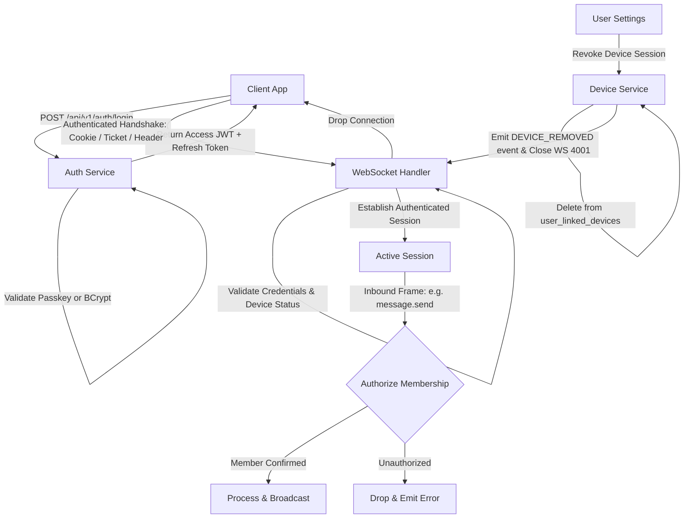

# Cross-Cutting Discipline: Threat Assessment, Secrets Management & Security Architecture

> **Engineering Standard: Zero-Trust Security & Supply Chain Defense**  
> Security is an architectural discipline spanning the entire software lifecycle—from Phase 4/5 (Threat Modeling & Design) to Phase 8 (Defensive Implementation), Phase 10 (Security Review & Secret Scanning), and Phase 12 (Validation). This guide establishes non-negotiable security policies for secrets prevention, authentication & authorization, input sanitization, and dependency supply-chain defense.

---

## 1. The Zero-Secrets Invariant & Multi-Stage Git Scanning

Accidental exposure of credentials, API keys, and cryptographic secrets is a severe security incident.

### Non-Negotiable Secrets Rules

1. **Never commit secrets**: No API keys, passwords, database credentials, JWT secret keys, or private certificates may exist in source code, commit history, documentation, or issue templates.
2. **Environment Variable Segregation**:
   * Commit template files only: [.env.example](../../.env.example).
   * Ensure all local `.env` and `.env.*` files containing real secrets are strictly listed in `.gitignore`.
   * Template values must be explicit dummy placeholders (e.g., `JWT_SECRET=replace_with_64_byte_hex_secret_in_production`).
3. **Log Sanitization**: Redact sensitive data before writing to logs. Use masking filters in logging formatters for Authorization headers, passwords, and query parameters.

### Multi-Stage Secret Scanning Standards

Simple keyword grep searches (e.g. `grep -i password`) **are not a complete secret scanner**; they miss high-entropy cryptographic keys, hex hashes, base64 strings, and non-obvious variable names.

#### Recommended Dedicated Scanners
When available, use dedicated Shannon-entropy and rule-based secret scanning tools:
* **Gitleaks**: `gitleaks detect --source=. -v`
* **Trufflehog**: `trufflehog git file://. --since-commit HEAD~1`
* **git-secrets**: Pre-commit hook preventing credential commits.

#### Segmented Git Inspection Protocol
Never rely solely on `git diff HEAD`, because it only checks tracked changes and completely misses untracked files:
```bash
# 1. Scan untracked files for accidentally created credentials
git ls-files --others --exclude-standard

# 2. Inspect unstaged working-tree changes
git diff

# 3. Inspect staged changes ready for commit
git diff --cached

# 4. Fallback pattern scan on staged diff (heuristic sanity check)
git diff --cached | grep -iE "(password|secret|token|api_key|private_key|bearer)"
```

> **Git Safety Rule**: Never run destructive commands that discard uncommitted changes (`git checkout .`, `git clean -fd`, `git reset --hard`) without explicit human confirmation.

---

## 2. Authentication, Authorization & Session Management

Implement a defense-in-depth security model across REST and WebSockets:



### Security Controls

1. **Password Hashing**: BCrypt with minimum work factor of 12 (or Argon2id).
2. **JWT Lifecycle**:
   * Short-lived Access Tokens (15–30 minutes) signed with HMAC-SHA256 (minimum 256-bit key) or RS256.
   * Long-lived Refresh Tokens stored in HTTP-only, Secure, SameSite cookies or persistent database sessions with rotation on every refresh.
3. **Session Revocation**: When a linked device is revoked via `DELETE /api/v1/devices/{deviceId}`, the WebSocket server immediately pushes a `DEVICE_REMOVED` event and closes the socket with status `4001`.
4. **WebSocket Authentication Guidance**:
   * **URL Query Parameter Warning**: Avoid recommending long-lived access tokens in WebSocket URLs (`/ws?token=<JWT>`) by default. URLs leak in HTTP server access logs (Tomcat, Nginx), reverse proxy logs, browser history, and APM traces.
   * **Preferred Approaches**: Use authenticated HTTP-only cookies on the HTTP upgrade handshake for browsers, short-lived single-use tickets (`POST /auth/ws-ticket` with 30s TTL in Redis), or handshake HTTP headers (`Authorization: Bearer <token>`) for native mobile and desktop clients.
   * **Log Redaction**: If query parameter tokens must be used for browser fallbacks, configure reverse proxies and application servers to mask or scrub the `token=` query string from access logs.
5. **Frame-Level Operation Authorization**: Authenticating the WebSocket connection is not enough. The server must verify that the session user is an authorized member of the specific conversation before processing any incoming action (`message.send`, `user.typing`, `message.read`).

---

## 3. Input Validation & Injection Prevention

Never trust client-supplied input:

### A. SQL Injection Prevention
* In Java/Spring Boot: Always use Spring Data JPA repository methods or parameterized JPQL queries with `:param` bindings.
* **Never concatenate user strings into SQL queries**:
  * *Vulnerable*: `entityManager.createNativeQuery("SELECT * FROM users WHERE name = '" + name + "'");`
  * *Secure*: `userRepository.findByName(name);` or `@Query("SELECT u FROM User u WHERE u.name = :name")`

### B. Cross-Site Scripting (XSS) Prevention
* React automatically escapes variables rendered in JSX expressions (`<div>{message.text}</div>`).
* **Forbidden**: Never use `dangerouslySetInnerHTML` unless rendering sanitized HTML that has passed through a hardened sanitizer (like DOMPurify).
* Enforce Content-Security-Policy (CSP) headers in production web servers.

### C. File Upload Security
* Restrict allowed MIME types (e.g., `image/jpeg`, `image/png`, `image/webp`, `video/mp4`, `application/pdf`).
* Never use the client-supplied filename directly on the filesystem or S3 bucket. Generate random UUID filenames (`UUID.randomUUID().toString() + extension`).
* Enforce maximum file size limits on both server (Spring `spring.servlet.multipart.max-file-size`) and client before upload begins.

---

## 4. Dependency Auditing & Supply Chain Defense

Third-party dependencies represent an attack vector for vulnerabilities and supply chain compromises:

```bash
# Audit Node.js workspace dependencies
npm audit

# Audit production dependencies only
npm audit --omit=dev

# Audit Java Maven dependencies
cd backend && mvn dependency:analyze
```

### Dependency Hygiene Rules:
1. **Pinned Lockfiles**: Always commit `package-lock.json` and use `npm ci` in automated CI/CD pipelines to guarantee deterministic builds.
2. **Evaluate New Dependencies**: Before adding an npm or Maven package, verify:
   * Is the package actively maintained?
   * How many open CVEs exist?
   * Does it have excessive transitive dependencies?
   * Can the functionality be achieved using 20 lines of standard code instead?

---

## 5. Network & Transport Security

* **Enforce TLS / HTTPS**: In production, all HTTP and WebSocket connections must be encrypted over TLS (`https://` and `wss://`).
* **CORS Policy**: Restrict CORS origins to trusted frontend domains. Never use `Access-Control-Allow-Origin: *` in endpoints handling authentication cookies or credentials.
* **Security Headers**: Configure Spring Security to emit standard HTTP security headers:
  * `X-Content-Type-Options: nosniff`
  * `X-Frame-Options: DENY`
  * `Strict-Transport-Security: max-age=31536000; includeSubDomains`
  * `Referrer-Policy: strict-origin-when-cross-origin`

---

## 6. Verified ECC Tools for Phase 10 (Security)

* **Agent `security-reviewer`**: Dedicated agent persona for vulnerability scanning, OWASP Top 10 auditing, and crypto review.
* **Workflow `workflows/security-scan.md`**: Automated security scan workflow across agent and code surfaces.
* **Rule `rules/common-security.md`**: Universal language-agnostic security rules.
* **Rule `rules/react-security.md`**: React-specific XSS and CSP rules.
* **Rule `rules/java-security.md`**: Spring Security, JWT, and SQL injection prevention rules.
