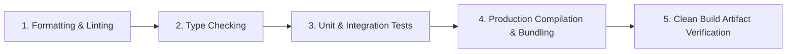
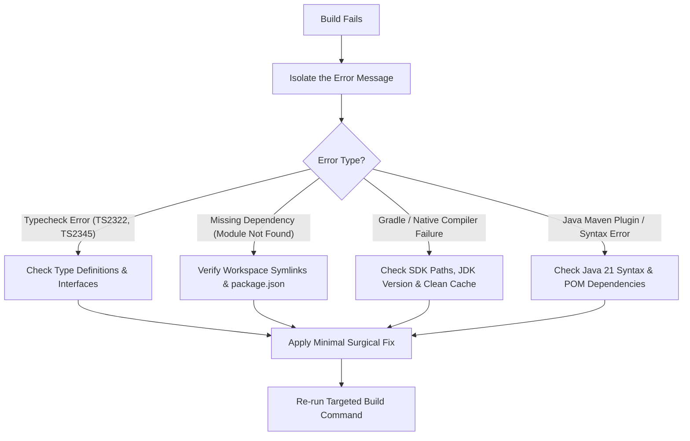

# Phase 12: Build Verification, Compilers & Static Analysis

> **Engineering Standard: Zero-Warning, Zero-Error Golden Pipeline**  
> Software must compile cleanly and pass static analysis on every supported platform before it is considered ready for testing or deployment. This guide defines the golden validation pipeline, monorepo orchestration, build troubleshooting, and stack-specific validation commands.

---

## 1. The Golden Validation Pipeline

Every code modification must progress through five progressive validation stages:



### Golden Pipeline Rules

1. **Never suppress compiler errors**: Do not use `@ts-ignore` or `@SuppressWarnings` to bypass legitimate type incompatibilities.
2. **Adhere to Project Quality Gates**: Treat unresolved compilation errors and project-configured warning gates as blockers. Distinguish new warnings introduced by your changes (which should be resolved) from pre-existing third-party dependency warnings or legacy compiler notices that cannot be safely altered without broader scope changes. Always document meaningful limitations or skipped checks.
3. **Validate Inter-Package Links First**: In monorepos, compile shared packages (`@chat/shared-types`) before validating dependent client apps.
4. **Categorize Validation Results Explicitly**: Always distinguish between checks that **Passed**, **Failed**, **Skipped** (with stated reason), and **Not Applicable** (when a platform is untouched). Never claim checks passed without executing them.

---

## 2. Monorepo Build Orchestration & Dependency Ordering

### A. Universal Build Discovery Principle
Before executing commands in any repository, detect the project's build system:
* Check for package manager: `package-lock.json` (npm), `pnpm-lock.yaml` (pnpm), `yarn.lock` (yarn), `bun.lockb` (bun).
* Check for backend build manifests: `pom.xml` (Maven), `build.gradle` (Gradle), `Cargo.toml` (Cargo), `go.mod` (Go).
* Discover scripts defined in package manifests (`npm run`, `mvn help:describe`) rather than assuming static commands.

### B. Project-Specific Workspace Validation Sequence (IndiChat)
*(See [PROJECT_CONTEXT.md](./PROJECT_CONTEXT.md) for full system profile)*:

```bash
# 1. Install and verify root workspace symlinks
npm install

# 2. Build shared types package (if dist build required)
npm --workspace=packages/shared-types run build --if-present

# 3. Validate Web client build (tsc && vite build)
npm run web:build

# 4. Validate Mobile TypeScript compilation
cd apps/mobile && npx tsc --noEmit

# 5. Validate Desktop package
npm --workspace=apps/desktop run pack --if-present

# 6. Validate Spring Boot backend build
npm run backend:build
# Or directly with local Maven:
cd backend && mvn clean package -DskipTests
```

---

## 3. Stack-Specific Build & Validation Reference

### A. Web Frontend (React 18 + TypeScript + Vite)

* **Configuration**: [apps/web/vite.config.ts](../../apps/web/vite.config.ts), [apps/web/tsconfig.json](../../apps/web/tsconfig.json)
* **Validation Command**:
  ```bash
  npm run web:build
  # Underlying command: tsc && vite build
  ```
* **Success Criteria**: Exit code 0, `dist/` directory generated containing optimized JavaScript and CSS bundles.

### B. Mobile Frontend (React Native + Expo)
* **Configuration**: [apps/mobile/app.json](../../apps/mobile/app.json), [apps/mobile/tsconfig.json](../../apps/mobile/tsconfig.json)
* **Type Validation**:
  ```bash
  cd apps/mobile && npx tsc --noEmit
  ```
* **Native Android Build Validation**:
  ```bash
  # Validate debug APK compilation via Gradle engine
  npm run build:android:apk
  ```

### C. Backend (Java 21 + Spring Boot 3.3.5)
* **Configuration**: [backend/pom.xml](../../backend/pom.xml)
* **Build Command**:
  ```bash
  # Local Maven build skipping tests
  cd backend && mvn clean package -DskipTests

  # Containerized build (reproducible JDK 21 environment)
  npm run backend:build
  ```
* **Success Criteria**: Exit code 0, `backend/target/chat-backend-1.0.0.jar` created.

### D. Linux Desktop Client (Electron 33+)
* **Configuration**: [apps/desktop/package.json](../../apps/desktop/package.json)
* **Build Command**:
  ```bash
  npm run build:linux:appimage
  # Or comprehensive multi-format build:
  npm run build:linux:all
  ```
* **Success Criteria**: Executable `.AppImage`, `.deb`, `.snap` files in `dist/` or `release/linux/`.

---

## 4. Build Error Resolution Protocol

When a build fails, do not guess. Follow this structured triage process:



### Common Monorepo Build Gotchas & Fixes:
| Symptom | Root Cause | Solution |
|---|---|---|
| `Cannot find module '@chat/shared-types'` | Monorepo symlinks broken in `node_modules` | Run `npm install` at root directory to refresh workspace links. |
| `Unsupported FormDataPart implementation` | Standard browser `FormData` used in React Native | Switch to `expo-file-system` (`uploadAsync` or `ExpoFile`). |
| Gradle `SDK location not found` | Missing `local.properties` or `ANDROID_HOME` | Let `scripts/build-android.js` generate `local.properties` or set `export ANDROID_HOME=$HOME/Android/Sdk`. |
| Java `class file has wrong version 65.0, should be 61.0` | JDK mismatch (Gradle running with Java 17 instead of Java 21) | Ensure Gradle runs with JDK 21 (`export JAVA_HOME=/usr/lib/jvm/java-21-...`). |

---

## 5. Verified ECC Tools for Phase 12

* **Agent `build-error-resolver`**: Universal build failure triage and compiler repair agent.
* **Agent `react-build-resolver`**: Specialized in Vite, JSX, and TypeScript React compiler issues.
* **Agent `java-build-resolver`**: Specialized in Maven, Spring Boot, and Java 21 compilation errors.
* **Workflow `workflows/build-fix.md`**: Detects project build system and incrementally repairs build errors.
* **Workflow `workflows/quality-gate.md`**: Enforces strict formatting and linting quality gates.
* **Workflow `workflows/react-build.md`**: Specialized React build resolution pipeline.
