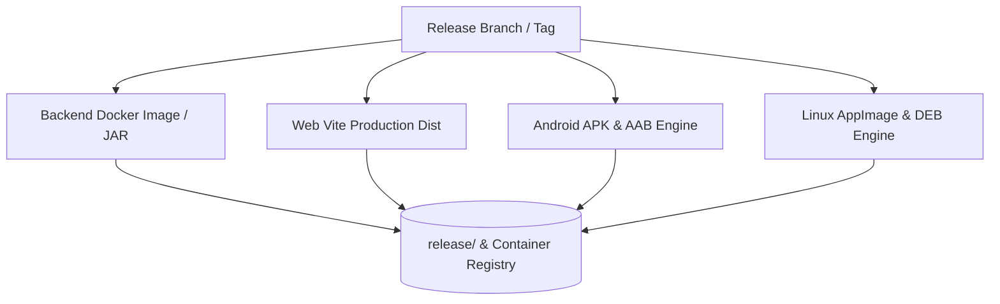
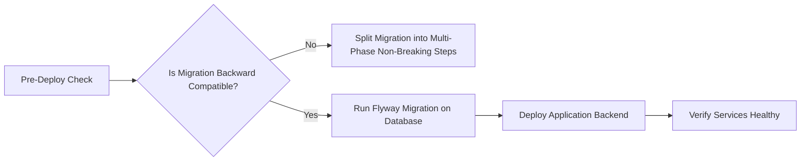
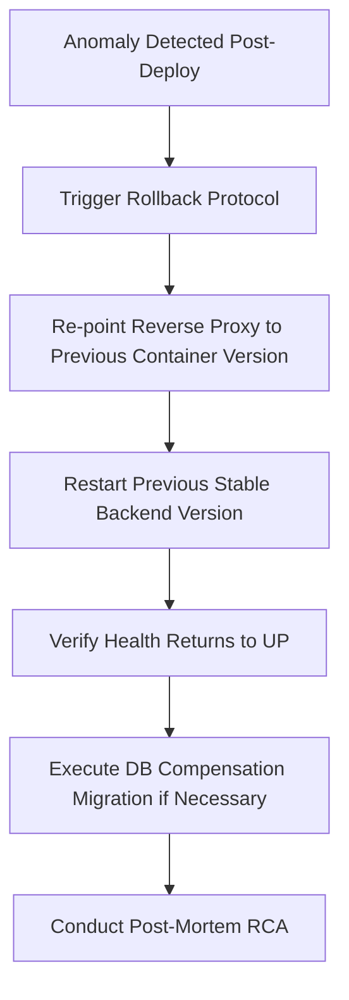

# Phase 15 & 16: Release Packaging, Environment Configuration & Deployment Readiness

> **Engineering Standard: High-Availability Releases & Controlled Rollbacks**  
> Deploying code to production is the highest-risk phase in the software lifecycle. This guide defines artifact compilation standards, database migration execution, CI/CD pipeline gates, explicit authorization procedures, and post-deployment health verification.

---

## 1. Release Packaging & Multi-Platform Compilation

IndiChat compiles production artifacts across Backend, Web, Mobile, and Desktop:



### Build Commands Reference:
1. **Android Binaries** (via [scripts/build-android.js](../../scripts/build-android.js)):
   ```bash
   # Build Release APK
   npm run build:android:apk
   # Output: release/android/IndiChat.apk (and app-release.apk)

   # Build Google Play App Bundle (.aab)
   npm run build:android:bundle
   # Output: release/android/IndiChat.aab (and app-release.aab)
   ```
2. **Linux Desktop Packages** (via [scripts/build-linux.js](../../scripts/build-linux.js)):
   ```bash
   npm run build:linux:all
   # Output: AppImage, .deb, .snap in release/linux/
   ```
3. **Backend Service Container**:
   ```bash
   docker build -t indichat/backend:latest ./backend
   ```
4. **Web Frontend Distribution**:
   ```bash
   npm run web:build
   # Output: apps/web/dist/
   ```

---

## 2. Environment Parity & Secrets Configuration

Ensure identical behavior across local, staging, and production environments:

* **The `.env.example` Synchronization Invariant**:
  Whenever a new configuration key is added in `application.yml` or frontend config, it must immediately be documented in [.env.example](../../.env.example) with a description and dummy default.
* **Secrets Management**:
  * Never bundle production secrets into client apps (Android APKs, Web bundles).
  * In production containers, inject secrets via environment variables or cloud secret managers (AWS Secrets Manager, HashiCorp Vault, Kubernetes Secrets).

---

## 3. Database Migration Deployment & Safety

Database schema changes can cause downtime if executed incorrectly.



### Safe Migration Deployment Rules

1. **Expand-Contract Pattern**:
   * Phase 1 (Expand): Add new column/table as nullable or with default. Deploy application code that writes to both old and new columns.
   * Phase 2 (Contract): Once all running instances are updated, deploy code reading exclusively from the new column. Drop old column in a subsequent scheduled release.
2. **Flyway Execution Timing & Immutability**:
   * Flyway runs automatically on Spring Boot application startup before HTTP traffic is accepted.
   * **Applied Migrations are Immutable**: Once a migration is applied, changing its SQL file triggers a fatal `FlywayException: Migration checksum mismatch` on subsequent boots. Corrective changes must always be made via a new forward migration (`V<N+1>__...sql`).
3. **PostgreSQL Concurrent Indexing Mechanics**:
   * **The Transaction Invariant**: `CREATE INDEX CONCURRENTLY` **cannot execute inside a PostgreSQL transaction block** (`ERROR: CREATE INDEX CONCURRENTLY cannot run inside a transaction block`).
   * **Flyway Script Configuration**: Because Flyway executes migrations inside a transaction by default, you must configure Flyway to execute the migration non-transactionally. Flyway Community Edition 10.x natively supports companion script configuration files:
     Create `<migration_file>.sql.conf` (e.g., `V5__add_messages_idx.sql.conf`) alongside the SQL file with:
     ```properties
     executeInTransaction=false
     ```
   * **Targeted Application & Failure Remediation**: Do not blindly recommend concurrent indexes for every index change. Standard transactional `CREATE INDEX` is atomic and rolls back cleanly on error—ideal for new tables, smaller tables, staging, and maintenance windows. Reserve `CONCURRENTLY` strictly for large, active production tables where an `ACCESS EXCLUSIVE` table lock would block incoming reads/writes. Because non-transactional execution cannot roll back on error, any failed or cancelled build leaves behind an `INVALID` index that continues to incur write overhead. It must be manually cleaned up via `DROP INDEX CONCURRENTLY IF EXISTS <index_name>;` and the Flyway history repaired before retrying (note that bare `mvn flyway:repair` fails in this project because datasource properties reside in `application.yml`; run with verified connection flags for local development: `mvn flyway:repair -Dflyway.url=jdbc:postgresql://localhost:5554/chat_platform -Dflyway.user=postgres -Dflyway.password=postgres`; in staging and production environments, substitute the target environment's actual database URL and inject credentials securely via environment variables or secret stores rather than default development values). Do not manually delete records from `flyway_schema_history` as a routine procedure; direct manual table edits risk corrupting checksum tracking and schema state. In high-stakes production environments, DBAs often execute concurrent index builds out-of-band directly on PostgreSQL, followed by a lightweight metadata baseline migration in Flyway.
4. **Table Locks & Large-Table Backfills**:
   * *Deployment-Impact Assessment (Do Not Assume Zero Downtime)*: Avoid claiming zero downtime merely because a column is nullable or has a default. In PostgreSQL 11+, adding a column with a constant default is metadata-only, but adding volatile defaults (e.g., non-immutable function calls like `clock_timestamp()`) forces a table rewrite. Furthermore, `ALTER TABLE ... ADD COLUMN` requires an `ACCESS EXCLUSIVE` lock briefly: under high query traffic, waiting for this lock can cause lock queue pileup and connection starvation unless guarded by a short `lock_timeout`. Always perform a migration and deployment-impact assessment.
   * Backfilling large tables with millions of rows must be batched (e.g., in chunks of 5,000–10,000 rows with pauses) to prevent transaction log exhaustion (WAL bloat) and row-lock contention.
5. **Recovery Taxonomy: Rollback vs. Recovery vs. Restoration**:
   * **Schema Rollback**: Flyway Community does NOT support automatic rollback or down migrations. Rollback requires applying an explicit forward compensation migration (`V<N+1>__revert_...sql`) or dropping newly created objects in pre-production.
   * **Roll-Forward Recovery**: Deploying a fast-follow fix migration that preserves dual-version application compatibility.
   * **Data Restoration**: Point-in-time recovery (PITR) or restoring from physical backups (pg_dump / pg_restore / WAL archiving) when actual data loss or corruption occurs. This is completely distinct from schema migration management.

---

## 4. Production Deployment Authorization Gate (Phase 16)

**NEVER deploy, publish, push commits to production branches, or modify production infrastructure without explicit, affirmative authorization from the user.**

### The Authorization Protocol:
When deployment readiness is achieved, present the deployment runbook and stop:

```markdown
### Deployment Authorization Request
- **Target Environment**: Production / Staging
- **Target Artifacts**: [IndiChat-release-2026-10-27.apk, Backend v1.2.0 Docker Image]
- **Database Migrations**: [V5__add_pinned_messages.sql (Assessed for locking, backfills, and backward compatibility)]
- **Rollback Artifact**: [Previous stable image: indichat/backend:1.1.9]
- **Downtime Expectation**: [e.g. Near-zero / Minimal rolling window / Scheduled maintenance: conditional on verified rolling deployment strategy, passing readiness/health checks, sufficient cluster capacity, and dual-version backward compatibility]

**Do you authorize executing this deployment now?**
```
*Wait for user to respond with "Deploy" or explicit approval.*

---

## 5. Post-Deployment Smoke Verification & Health Checks

Immediately after deploying containers or services, run the post-deployment smoke suite:

1. **Service Health Check**:
   ```bash
   curl -s -i http://localhost:8080/actuator/health
   # Must return HTTP 200 OK with {"status":"UP"}
   ```
2. **Database & Redis Connectivity**:
   Inspect health component breakdown to confirm PostgreSQL and Redis connections are active:
   ```bash
   curl -s http://localhost:8080/actuator/health | jq .components
   ```
3. **WebSocket Handshake Verification**:
   Execute synthetic handshake test:
   ```bash
   node scripts/verify_ws.js
   ```
4. **Log Inspection**:
   Tail production container logs for 60 seconds to ensure zero uncaught exception spikes:
   ```bash
   docker logs --tail 100 -f indichat-backend
   ```

---

## 6. Immediate Rollback Protocol

If health checks fail, error rates spike above 1%, or critical regressions appear:



### Rollback Steps:
1. Re-tag or redeploy the prior known good container image (`indichat/backend:previous-stable`).
2. If schema changes prevent the old code from running, apply the prepared compensation migration immediately.
3. Notify the team and initiate Phase 10 RCA (Root Cause Analysis).

---

## 7. Verified ECC Tools for Phase 15 & 16

* **Skill `skills/production-audit`**: Pre-launch readiness audit assessing configuration, performance, and failure surfaces.
* **Skill `skills/delivery-gate`**: Quality gating tool enforcing release criteria before shipping.
* **Agent `chief-of-staff`**: Orchestrates release checklists and rollout schedules.
* **Workflow `workflows/pm2.md`**: Process management and service supervision.
