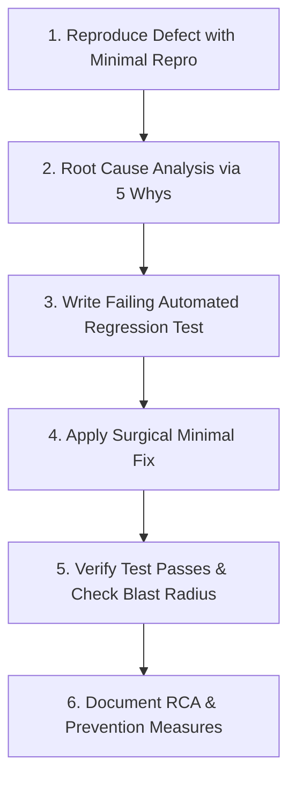

# Specialized Workflow: Systematic Bug Reproduction, Root Cause Analysis & Regression Prevention

> **Engineering Standard: Surgical Fixes & Permanent Regression Prevention**  
> Bug fixes must never be trial-and-error hacks. Every reported defect must follow a rigorous 6-step lifecycle: Reproduce -> Root Cause Analysis -> Failing Regression Test -> Surgical Minimal Fix -> Blast Radius Verification -> Post-Mortem Documentation.

---

## 1. The 6-Step Defect Resolution Pipeline



---

## 2. Step 1: Systematic Reproduction

Never attempt to fix a bug you cannot reliably reproduce:

1. **Gather Context**:
   * Exact client platform (Web, Android, Desktop), OS version, browser engine.
   * Specific inputs, payload data, and sequence of user interactions.
   * Server logs, client console output, and network payload traces.
2. **Construct a Minimal Reproducible Example (MRE)**:
   * Strip away irrelevant state, extra UI components, or unrelated API calls.
   * Formulate an automated reproduction: a `curl` command sequence, a standalone Node.js script, or a focused unit test.

---

## 3. Step 2: Root Cause Analysis (RCA) & The 5 Whys

Avoid patching symptoms. Dig down to the root systemic failure using the **5 Whys Methodology**:

### Example RCA Case:
* *Symptom*: Mobile app displays blank white screen when opening chat with new user.
* *Why 1?*: Uncaught TypeError: `Cannot read property 'url' of undefined`.
* *Why 2?*: Component tried to access `message.attachment.url` when attachment was null.
* *Why 3?*: Backend sent `attachment: null` for text-only messages, but client expected object.
* *Why 4?*: Shared TypeScript type had `attachment?: AttachmentDTO`, but frontend assumed it was always present if `message.type === 'MEDIA'`.
* *Why 5? (Root Cause)*: Backend message entity serialization had inconsistent null handling for system-generated media place-holders.

### Diagnostic Techniques:
* **Stack Trace Deconstruction**: Locate the topmost line in the stack trace belonging to project code (ignoring framework internals).
* **Git Bisect**: When a bug is a recent regression, use binary search across git commits:
  ```bash
  git bisect start
  git bisect bad HEAD
  git bisect good <commit-hash-where-it-worked>
  git bisect run npm test
  ```

---

## 4. Step 3: Write the Failing Regression Test (TDD Red)

Before touching a single line of production code, capture the bug in an automated test:

```typescript
// Regression Test: Bug #204 - Null attachment in text messages must not crash bubble
test('should render message text gracefully when attachment field is null', () => {
  // Arrange
  const textMessageWithoutAttachment: MessageDTO = {
    id: 'msg-99',
    conversationId: 'conv-1',
    senderId: 'usr-2',
    content: 'Hello World',
    attachment: null, // Triggers the reported bug
    status: 'sent',
    createdAt: new Date().toISOString()
  };

  // Act & Assert
  const { queryByText } = render(<MessageBubble message={textMessageWithoutAttachment} />);
  expect(queryByText('Hello World')).toBeInTheDocument();
});
```

* **Verify Failure**: Run the test and confirm it fails with the exact error reported in the bug ticket.

---

## 5. Step 4: Apply the Surgical Minimal Fix (TDD Green)

Fix only what is broken:

* **Surgical Precision**: Touch the minimum number of lines necessary to resolve the root cause.
* **Resist the Urge to Refactor**: Do not reformat surrounding code, reorganize imports, or optimize unrelated algorithms within a bug fix commit.
* **Preserve Contract Invariants**: Ensure the fix does not inadvertently alter API shapes or break existing callers.

---

## 6. Step 5: Verify Fix & Check Blast Radius

1. **Run Targeted Regression Test**: Verify the failing test now passes with flying colors.
2. **Run Full Test Suite for Modified Module**: Ensure zero sibling tests were broken by the fix.
3. **Verify Edge Cases**: Test boundary conditions related to the fix (empty strings, nulls, high concurrency).

---

## 7. Step 6: Document Post-Mortem & Prevention

For high or critical severity defects, document a concise Post-Mortem in the task notes or pull request:

```markdown
### Bug Resolution & RCA Summary
- **Defect Description**: Mobile white-screen crash on text message render.
- **Root Cause**: Missing null check on optional `attachment` property in `MessageBubble.tsx:42`.
- **Surgical Fix**: Added optional chaining `message.attachment?.url` and default fallback.
- **Regression Test Added**: `ChatWindow.test.tsx#testRenderNullAttachment`.
- **Systemic Prevention**: Updated `@chat/shared-types` with strict non-nullable discriminant unions.
```

---

## 8. Verified ECC Tools for Bug Fixing

* **Workflow `workflows/orch-fix-defect.md`**: Orchestrated bug fixing workflow with regression testing.
* **Agent `silent-failure-hunter`**: Specializes in detecting swallowed errors and uncaught promises.
* **Agent `tdd-guide`**: Guides regression test creation.
* **Skill `skills/agent-introspection-debugging`**: Structured self-debugging workflow for complex logic bugs.
