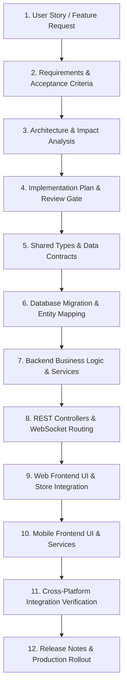

# Specialized Workflow: Cross-Platform Feature Development Pipeline

> **Engineering Standard: End-to-End Feature Delivery**  
> Implementing a feature across a multi-platform monorepo requires a disciplined, layered sequencing strategy to avoid contract mismatches, compilation breaks, and state desynchronization. This guide provides the complete end-to-end feature pipeline from conception to cross-platform verification.

---

## 1. The End-to-End Feature Lifecycle Flow



---

## 2. Cross-Layer Implementation Sequencing Standard

In a monorepo containing shared packages, backend services, and multiple client applications, implement changes in this strict order:

### Stage 1: Contract First (`packages/shared-types/`)
Always define the data contracts and event types before writing backend or frontend implementations:
1. Open [packages/shared-types/src/index.ts](../../packages/shared-types/src/index.ts).
2. Declare request/response DTOs, interfaces, and enums.
3. Declare WebSocket event types and payload mappings.
4. Verify shared types compile cleanly:
   ```bash
   npm --workspace=packages/shared-types run build --if-present
   ```

### Stage 2: Database Schema & Entity Mapping (`backend/`)
If the feature requires persistence:
1. Create a new append-only Flyway migration:
   `backend/src/main/resources/db/migration/V<N>__<feature_name>.sql`.
2. Add necessary columns, constraints, and indexes using PostgreSQL dialect.
3. Update or create JPA Entity classes in `backend/src/main/java/com/chat/.../`.
4. Ensure all foreign keys are indexed; assess migration safety (locking, backfills, constant defaults) before adding non-null constraints.

### Stage 3: Backend Domain Services & Logic (`backend/`)
1. Write unit tests for the domain service (`*ServiceTest.java`).
2. Implement business rules, validation, and transaction handling in the Service layer.
3. Integrate Redis caching or pub/sub if real-time synchronization is needed.

### Stage 4: REST Endpoints & WebSocket Handlers (`backend/`)
1. Expose REST endpoints in `@RestController` following `/api/v1/...` naming conventions.
2. If real-time duplex streaming is needed, update `ChatWebSocketHandler.java` to handle new event types.
3. Implement authorization checks: verify user session and conversation membership.

### Stage 5: Web Frontend Implementation (`apps/web/`)
1. Update API client in `apps/web/src/services/api.ts` to consume new REST endpoints.
2. Update WebSocket listeners to handle new incoming events.
3. Build or update reusable UI components using Vanilla CSS tokens in `apps/web/src/features/...`.
4. Validate web build: `npm run web:build`.

### Stage 6: Mobile Frontend Implementation (`apps/mobile/`)
1. Update mobile API client in `apps/mobile/services/api.ts`.
2. Update WebSocket handler in `apps/mobile/services/websocket.ts`.
3. Build or update screens in `apps/mobile/app/...`.
4. Ensure responsive handling with `<SafeAreaView>` and `<KeyboardAvoidingView>`.
5. Validate mobile TypeScript compilation: `cd apps/mobile && npx tsc --noEmit`.

---

## 3. Feature Flagging & Progressive Rollout

When building large or multi-phase features, protect production stability using feature flags:

```typescript
// Shared Feature Configuration
export const FEATURE_FLAGS = {
  VOICE_MESSAGES_ENABLED: false, // Inactive in production until fully tested
  STATUS_STORIES_ENABLED: true,
  CALLS_ENABLED: true,
};

// Component Gating Example
export function ChatInputActions() {
  return (
    <div className="chat-actions">
      <AttachmentButton />
      {FEATURE_FLAGS.VOICE_MESSAGES_ENABLED && <VoiceRecordButton />}
      <SendButton />
    </div>
  );
}
```

### Feature Flagging Guidelines:
* **Decouple Deployment from Release**: Code can be deployed to production safely behind an inactive flag while remaining dormant.
* **Retire Flags Promptly**: Once a feature is 100% stable in production, remove the conditional flag check to avoid dead code accumulation.

---

## 4. Cross-Platform End-to-End Verification

Before closing the feature task:
1. Verify REST API returns correct payloads using `curl` or automated API tests.
2. Run WebSocket protocol verification: `node scripts/verify_ws.js`.
3. Open Web client (`http://localhost:5174`) and verify layout and interactions.
4. Verify Mobile client compilation and Android APK build: `npm run build:android:apk`.
5. Audit the Requirements Traceability Matrix (RTM) to ensure 100% of acceptance criteria are satisfied.

---

## 5. Verified ECC Tools for Feature Development

* **Workflow `workflows/feature-dev.md`**: Guided feature development with codebase understanding.
* **Workflow `workflows/orch-add-feature.md`**: End-to-end orchestrated feature builder (Plan -> TDD -> Code -> Review).
* **Workflow `workflows/orch-build-mvp.md`**: Scaffolding and bootstrapping larger multi-file features.
* **Agent `planner`**: High-level task decomposition and sequencing.
* **Agent `architect`**: Cross-platform system architecture and interface consistency.
