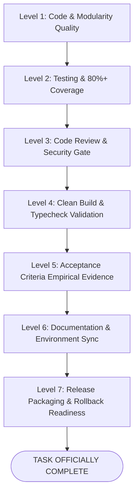

# Universal Definition of Done (DoD) & Quality Checklist

> **Engineering Standard: The 7-Level Completion Gate**  
> In professional software engineering, **code written does not equal task done**.  
> A task, pull request, or release is only "Done" when it satisfies all seven verification levels defined below. Never close a ticket or declare completion based on assumptions.

---

## The 7-Level Definition of Done Hierarchy

---

## Level 1: Code & Modularity Standards

- [ ] **Modularity & Single Responsibility**:
  - Functions and files maintain single responsibility; size guidelines (~50 lines/function, ~800 lines/file) used as heuristic review signals rather than dogmatic blockers that force unnatural file fragmentation.
  - Nesting depth is kept low (at or below 4 levels; early returns/guard clauses handle boundary states).
- [ ] **Clean Coding Principles**:
  - Follows SOLID principles appropriate to paradigm (Spring OO / React Components).
  - Explicit error handling: zero swallowed exceptions, zero empty `catch` blocks.
  - No leftover temporary debugging statements (`console.log`, `print`, `debugger`).
  - No commented-out dead code blocks committed.
- [ ] **Contract Integrity**:
  - Shared models declared in [packages/shared-types/src/index.ts](../../packages/shared-types/src/index.ts).
  - Clean separation of concerns between Controllers, Services, and Repositories.

---

## Level 2: Testing & Coverage Standards

- [ ] **Meaningful Automated Testing**:
  - Automated tests cover core business logic, state transitions, security boundaries, and regression risks.
  - Target 80%+ coverage on critical domain models and services as a quality guide, without demanding low-value tests on trivial getters or UI boilerplate.
- [ ] **TDD Discipline**: Tests written first where practical; verified to fail before implementation.
- [ ] **AAA Pattern**: All tests structured with Arrange-Act-Assert blocks and descriptive behavior names.
- [ ] **Zero Regressions**: 100% of existing unit and integration tests continue to pass cleanly.
- [ ] **No Flakiness**: Zero arbitrary `sleep()` calls; deterministic clocks used for time-sensitive tests.

---

## Level 3: Code Review & Security Gate

- [ ] **Segmented Pre-Review Git Inspection**:
  - Untracked files (`git ls-files --others --exclude-standard`), unstaged changes (`git diff`), and staged changes (`git diff --cached`) inspected separately.
  - Line-by-line review confirms zero unintended edits, stray logs, or whitespace churn.
- [ ] **Severity Standards**:
  - ZERO unaddressed CRITICAL severity issues (Security vulnerabilities, data loss).
  - ZERO unaddressed HIGH severity issues (Functional bugs, N+1 queries, unhandled promises).
  - All MEDIUM issues addressed or tracked in tech debt backlog.
- [ ] **Zero Secrets Invariant**:
  - No hardcoded API keys, passwords, private keys, or tokens in code or commits.
  - Secret scanning executed via Gitleaks/Trufflehog or multi-stage inspection.
  - Log sanitization in place; zero PII or credentials logged.
- [ ] **Injection & Sanitization**:
  - Parameterized database queries used exclusively (zero string concatenation in SQL).
  - User-generated content properly escaped to prevent XSS.
  - File uploads strictly restricted by MIME type and size with randomized UUID storage keys.

---

## Level 4: Build & Static Analysis Validation

- [ ] **Clean Compilation Across Relevant Platforms**:
  - Build command exits with code 0 across all touched packages (see [PROJECT_CONTEXT.md](./PROJECT_CONTEXT.md)):
    - Web: `npm run web:build` (`tsc && vite build`) passes.
    - Mobile: `cd apps/mobile && npx tsc --noEmit` passes.
    - Backend: `mvn clean package -DskipTests` or `npm run backend:build` succeeds.
- [ ] **Static Analysis & Linters**: Zero linter errors; formatting adheres to project conventions.
- [ ] **Zero Hallucinated Passes**: All build and validation commands were genuinely executed and verified. Results explicitly distinguished between **Passed**, **Failed**, **Skipped** (with reason), and **Not Applicable**.

---

## Level 5: Acceptance Criteria & Empirical Proof

- [ ] **Requirements Traceability Matrix (RTM)**:
  - 100% of functional acceptance criteria verified with empirical evidence.
  - Critical boundary conditions, error paths, and regression risks verified via risk-based testing.
  - Any known edge cases or untested paths explicitly documented with technical rationale and follow-up tracking.
- [ ] **Empirical Proof Attached**:
  - Real terminal output, test report, API JSON response, or browser UI state captured as evidence.
- [ ] **Negative & Failure Flows Tested**:
  - Invalid auth tokens return 401.
  - Malformed payloads return 400 with actionable error messages.
  - Network disconnects handle reconnection gracefully.

---

## 6. Level 6: Documentation & Environment Sync

- [ ] **API Contracts Synchronized**: [docs/api-contracts.md](../api-contracts.md) reflects all added/modified endpoints and WebSocket events.
- [ ] **Database Schema Synchronized**: [docs/database-schema.md](../database-schema.md) reflects all migrations and table changes.
- [ ] **Environment Template Synchronized**: [.env.example](../../.env.example) updated with any new required configuration keys.
- [ ] **Operational Guides Updated**: [AGENTS.md](../../AGENTS.md) and [README.md](../../README.md) updated if operational commands changed.
- [ ] **Changelog Entry Added**: Structured entry added following Keep a Changelog standards.

---

## Level 7: Deployment & Rollback Readiness

- [ ] **Database Migration Safety**:
  - Migrations are strictly append-only (no modified existing Flyway migrations).
  - Migration safety and deployment-impact assessment completed: evaluate table locking (avoiding unconstrained `ACCESS EXCLUSIVE` locks via short `lock_timeout`), backfill batching for large tables, default expression volatility (avoiding non-immutable functions that rewrite tables), dual-version application compatibility (Expand-Contract), and deployment impact. Never infer zero downtime from nullability or defaults alone.
- [ ] **Release Packaging**:
  - Production artifacts compiled and stored in `release/` or container registry.
- [ ] **Rollback Plan Prepared**:
  - Explicit rollback steps documented in case of post-deployment failure.
- [ ] **Deployment Authorization**:
  - User or lead engineer has explicitly granted affirmative approval to deploy.

---

## Final Sign-Off Checklist

Before submitting a Pull Request or declaring a task complete, verify this final sign-off:

| DoD Gate Level | Responsible Role | Verification Method | Status |
|---|---|---|---|
| Level 1: Code & Modularity | Software Engineer | Code inspection: responsibility, cohesion, and complexity review (size thresholds as non-blocking signals) | [ ] Pass |
| Level 2: Testing & Coverage | Software Engineer / QA | Test runner output, coverage report | [ ] Pass |
| Level 3: Review & Security | Lead Reviewer / Security Agent | Diff review, security scan | [ ] Pass |
| Level 4: Build & Validation | CI Engine / Build Resolver | Clean build logs (Exit 0) | [ ] Pass |
| Level 5: Acceptance Criteria | QA / Product Lead | RTM with empirical evidence | [ ] Pass |
| Level 6: Documentation Sync | Tech Writer / Doc Updater | Doc file diffs, .env.example | [ ] Pass |
| Level 7: Release Readiness | DevOps / Release Manager | Packaging artifacts, rollback plan | [ ] Pass |
