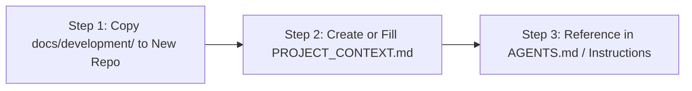

# Project Context & Portability Adaptation Guide

> **Engineering Standard: Cross-Stack Portability & Repository Onboarding**  
> This playbook (`docs/development/`) provides adaptable software engineering standards designed for cross-stack development. Universal principles (testing, code review, modularity, security) apply across all ecosystems, while stack-specific commands and paths are configured conditionally via [PROJECT_CONTEXT.md](./PROJECT_CONTEXT.md).

---

## 1. How to Port This Playbook to Another Repository

To introduce this engineering system into another project, follow this 3-step process:



### Step 1: Copy Directory
Copy the entire `docs/development/` directory into the new project:
```bash
cp -r /path/to/source/docs/development /path/to/target-repo/docs/
```

### Step 2: Configure `PROJECT_CONTEXT.md`
Fill out the configuration template below and save it as `docs/development/PROJECT_CONTEXT.md`.

### Step 3: Add Pointer to Agent Instructions
Add the minimal instruction snippet to the target project's `AGENTS.md`, `CLAUDE.md`, or system prompt:
```markdown
## Development Playbook & Engineering Standards
Follow the phase-based engineering standards defined in `docs/development/README.md`.
Refer to `docs/development/PROJECT_CONTEXT.md` for project-specific commands and ports.
```

---

## 2. Universal vs. Project-Specific Elements

When adopting this playbook, understand what remains constant vs. what adapts:

| Universal Invariants (Zero Modification Needed) | Project-Specific Adaptations (Configured in Profile) |
|---|---|
| **17-Phase Development Lifecycle** (Phase 1–17 sequence) | **Build & Compile Commands** (`npm build`, `mvn package`, `cargo build`, `dotnet build`) |
| **TDD Workflow** (Red-Green-Refactor, AAA Pattern) | **Testing Commands** (`pytest`, `go test`, `mvn test`, `npm test`) |
| **Modularity & Complexity Benchmarks** (Single responsibility, cognitive complexity review signals) | **Linter & Formatter Commands** (`eslint`, `ruff`, `golangci-lint`, `checkstyle`) |
| **Code Review Severity Tiers** (CRITICAL, HIGH, MEDIUM, LOW) | **Local Port Numbers & Services** (Postgres, MySQL, Redis, MongoDB, Kafka) |
| **Zero Secrets Policy** & Input Sanitization Rules | **Deployment Target** (Docker, Kubernetes, AWS, GCP, Azure, Bare Metal) |
| **Evidence-Based QA Ethos** & Requirements Traceability | **Database Migration Engine** (Flyway, Liquibase, Prisma, Alembic, Goose) |

---

## 3. Technology Stack Discovery Cheat-Sheet

Use this table to quickly identify build, test, and lint commands when onboarding an unfamiliar repository:

| Detected Files | Ecosystem | Discover Build Command | Discover Test Command | Discover Lint/Format |
|---|---|---|---|---|
| `package.json` | Node / TS / React | Inspect `scripts.build` in `package.json` | Inspect `scripts.test` in `package.json` | `npm run lint` / `npx prettier` |
| `pom.xml` | Java / Maven | `mvn clean package -DskipTests` | `mvn test` | `mvn checkstyle:check` |
| `build.gradle` | Java / Kotlin / Gradle | `./gradlew build -x test` | `./gradlew test` | `./gradlew spotlessCheck` |
| `pyproject.toml` | Python / Poetry | `poetry build` | `poetry run pytest` | `poetry run ruff check` |
| `requirements.txt` | Python / Pip | `python setup.py build` | `pytest` | `flake8` / `black --check` |
| `go.mod` | Golang | `go build ./...` | `go test -v ./...` | `golangci-lint run` |
| `Cargo.toml` | Rust | `cargo build --release` | `cargo test` | `cargo clippy` / `cargo fmt --check` |
| `*.csproj`, `*.sln`| .NET / C# | `dotnet build -c Release` | `dotnet test` | `dotnet format --verify-no-changes` |
| `docker-compose.yml`| Container Stack | `docker compose build` | `docker compose run --rm test` | `hadolint Dockerfile` |

---

## 4. Reusable Project Context Template (`PROJECT_CONTEXT.md`)

Copy the template below to `docs/development/PROJECT_CONTEXT.md` in any new repository and replace the placeholders:

```markdown
# Project Context: [PROJECT_NAME]

## 1. System Overview
- **Repository Name**: `[PROJECT_NAME]`
- **Primary Domain**: `[e.g. Real-Time Messaging / Fintech / E-Commerce / Healthcare]`
- **Architecture**: `[Monorepo / Microservices / Monolith]`
- **Primary Languages**: `[e.g. TypeScript, Java, Python, Go]`
- **Primary Frameworks**: `[e.g. React 18/19, Spring Boot 3.x, Expo 57, Next.js]`

## 2. Infrastructure & Port Allocations
| Service / Component | Default Port | Environment Variable | Notes |
|---|---|---|---|
| Primary Database | `[5432 / 3306]` | `DATABASE_URL` | PostgreSQL / MySQL |
| Cache / PubSub | `[6379]` | `REDIS_URL` | Redis / KeyDB |
| Object Storage | `[9000]` | `S3_ENDPOINT` | MinIO / AWS S3 |
| Backend API | `[8080 / 3000]` | `PORT` | REST / WebSocket API |
| Web Frontend | `[5173 / 3000]` | `WEB_PORT` | Vite / Next.js dev server |

## 3. Canonical Engineering Commands
### Build & Validation
- **Install Dependencies**: `[npm install / poetry install / mvn install]`
- **Type Check**: `[npx tsc --noEmit / mypy .]`
- **Lint & Format Check**: `[npm run lint / ruff check .]`
- **Compile Production Artifacts**: `[npm run build / mvn clean package -DskipTests]`

### Testing
- **Run All Unit Tests**: `[npm test / mvn test / pytest]`
- **Run Targeted Test File**: `[npm test -- <path> / mvn test -Dtest=<Class>]`
- **Run Integration Tests**: `[npm run test:integration / mvn verify]`
- **Check Test Coverage**: `[npm test -- --coverage / pytest --cov]`

### Local Development Runtime
- **Start Infrastructure**: `docker compose up -d`
- **Start Backend**: `[mvn spring-boot:run / npm run dev]`
- **Start Frontend**: `[npm run dev]`

## 4. Fundamental Repository Invariants
1. **Migration Policy**: `[e.g. Append-only Flyway migrations in src/main/resources/db/migration/]`
2. **Contract Source of Truth**: `[e.g. packages/shared-types or OpenAPI specs in docs/openapi.yaml]`
3. **Secret Management**: `[e.g. Never commit .env, use .env.example with placeholders]`
4. **Platform Specifics**: `[e.g. Mobile Android connects via host LAN IP or 10.0.2.2 for emulator]`

## 5. Contact Points & External References
- **Lead Architect / Maintainer**: `[NAME / GITHUB_HANDLE]`
- **Production URL**: `[URL]`
- **Staging / CI URL**: `[CI_PIPELINE_URL]`
```
