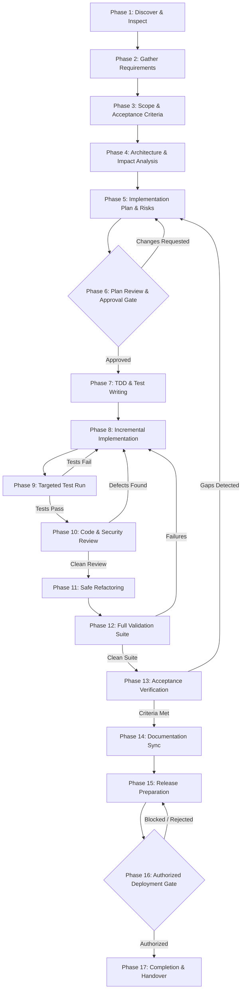

# The 17-Phase Development Lifecycle & Quality Gates

> **Standard Operating Lifecycle**  
> This document defines the canonical 17-phase engineering lifecycle. Every non-trivial development task must advance through these phases or an approved subset (see [Task Selection Decision Matrix](./README.md#2-task-selection-decision-matrix)).  
> Work flows sequentially, but regressions and loop-backs to earlier phases are mandatory whenever tests fail, reviews uncover defects, or requirements shift.

---

## Lifecycle Overview & Progression Flow

---

## Phase 1: Discover the Project and Inspect Existing Code

* **Objective**: Gain a grounded understanding of the repository structure, active dependencies, runtime ports, git status, and existing conventions before designing or proposing changes.
* **Inputs & Prerequisites**: Workspace access, repository path, initial user prompt or issue description.
* **Actions to Perform**:
  1. Inspect Git status, active branch, and recent uncommitted changes: `git status -s`.
  2. Inspect root configuration files (`package.json`, `pom.xml`, `docker-compose.yml`, `AGENTS.md`).
  3. Identify which workspace packages/modules are touched by the task.
  4. Search for existing implementations or utility functions that can be reused rather than re-invented.
* **Verified ECC Skills / Agents / Workflows**:
  * Agent: `code-explorer`, `architect`
  * Skill: `skills/codebase-onboarding`
  * Workflow: `workflows/project-init.md`
* **Recommended Agent Prompt**:
  > *"Inspect the repository structure, git status, package manifests, and existing documentation relevant to [TASK_DESCRIPTION]. Identify existing patterns and utilities that can be leveraged without introducing new dependencies."*
* **Expected Outputs & Artifacts**: Discovery summary listing detected tech stacks, key entry points, and reusable modules.
* **Validation Criteria**: The agent cites exact file paths and line numbers; zero assumptions about packages or frameworks.
* **Exit Criteria**: Repository state is verified, clean, and baseline understanding is established.
* **Stop / Loop-Back Condition**: If working tree has uncommitted conflicting edits, pause and request guidance before proceeding.
* **User Approval Required?**: No (Read-only inspection).

---

## Phase 2: Gather Requirements and Clarify Ambiguity

* **Objective**: Transform vague or underspecified requests into unambiguous functional and non-functional requirements.
* **Inputs & Prerequisites**: Output of Phase 1; user task description or issue ticket.
* **Actions to Perform**:
  1. Parse the request for ambiguities, unstated assumptions, and missing edge cases.
  2. Formulate 1 to 3 targeted, concise clarification questions (with concrete options).
  3. Validate non-functional constraints (latency budgets, concurrency, security, offline behavior).
* **Verified ECC Skills / Agents / Workflows**:
  * Agent: `spec-miner`, `planner`
  * Skill: `skills/product-lens`
  * Workflow: `workflows/aside.md` (for quick queries)
* **Recommended Agent Prompt**:
  > *"Analyze the requirements for [FEATURE_OR_TASK]. Identify any underspecified behaviors, edge cases, or platform constraints. List clarifying questions with recommended defaults."*
* **Expected Outputs & Artifacts**: Structured requirement specification covering inputs, outputs, states, and error behaviors.
* **Validation Criteria**: Every ambiguity has a documented decision or user confirmation.
* **Exit Criteria**: Scope and behavior are mutually understood by engineer and user.
* **Stop / Loop-Back Condition**: If user intent is fundamentally contradictory, stop and await user clarification.
* **User Approval Required?**: Yes, when clarifying major business rules or architectural trade-offs.

---

## Phase 3: Define Scope, Acceptance Criteria, Constraints, and Success Metrics

* **Objective**: Establish strict project boundaries, testable acceptance criteria, and explicit non-goals.
* **Inputs & Prerequisites**: Clarified requirements from Phase 2.
* **Actions to Perform**:
  1. Write Given-When-Then acceptance criteria for all functional flows.
  2. Define boundary conditions (payload limits, authentication states, error statuses).
  3. Define non-goals to prevent scope creep.
  4. Establish measurable success metrics (e.g., zero build warnings, API response < 100ms).
* **Verified ECC Skills / Agents / Workflows**:
  * Agent: `spec-miner`, `planner`
  * Workflow: `workflows/plan-prd.md`
* **Recommended Agent Prompt**:
  > *"Define formal acceptance criteria (Given-When-Then), platform constraints, and explicit non-goals for [FEATURE_NAME]. Structure criteria so each is independently testable."*
* **Expected Outputs & Artifacts**: Acceptance Criteria Matrix (to be tracked through Phase 13).
* **Validation Criteria**: Every criterion is binary (Pass/Fail) and verifiable via automated test or manual proof.
* **Exit Criteria**: Criteria are documented and ready to anchor test-driven development.
* **Stop / Loop-Back Condition**: If acceptance criteria require altering core project invariants, return to Phase 2.
* **User Approval Required?**: No (unless modifying contract with stakeholders).

---

## Phase 4: Analyze Architecture, Dependencies, Integrations, and Side Effects

* **Objective**: Evaluate how proposed changes impact existing data models, API contracts, network protocols, and client platforms.
* **Inputs & Prerequisites**: Scope & Acceptance Criteria from Phase 3; codebase architecture docs.
* **Actions to Perform**:
  1. Analyze blast radius across monorepo layers (Backend -> Shared Types -> Web -> Mobile).
  2. Verify database migration implications (PostgreSQL / Flyway append-only rules).
  3. Check real-time WebSocket protocol event impacts.
  4. Evaluate potential regressions in linked devices, offline syncing, or push notifications.
* **Verified ECC Skills / Agents / Workflows**:
  * Agent: `architect`, `database-reviewer`
  * Skill: `skills/architecture-decision-records`
  * Rule: `rules/common-patterns.md`, `rules/java-patterns.md`, `rules/react-patterns.md`
* **Recommended Agent Prompt**:
  > *"Perform an architectural impact analysis for [PROPOSED_CHANGE]. Identify all impacted modules, database entities, WebSocket events, and cross-platform clients. Highlight potential regression risks."*
* **Expected Outputs & Artifacts**: Architectural Impact & Side-Effect Assessment.
* **Validation Criteria**: All cross-boundary dependencies and migration needs are mapped.
* **Exit Criteria**: Blast radius is documented with zero unknown integration points.
* **Stop / Loop-Back Condition**: If proposed change breaks public API backwards compatibility, stop and evaluate versioning.
* **User Approval Required?**: No.

---

## Phase 5: Create an Implementation Plan with Affected Files, Technical Decisions, Migration Requirements, and Risks

* **Objective**: Produce a granular, step-by-step engineering plan mapping exact file edits, schema migrations, and rollback strategies.
* **Inputs & Prerequisites**: Architecture analysis from Phase 4.
* **Actions to Perform**:
  1. Draft a file-level modification table (Target File, Function/Section, Change Rationale).
  2. Specify new Flyway migrations (`V<N>__<name>.sql`) if database changes are needed.
  3. Define the exact order of execution (Shared Types -> Backend -> Frontend).
  4. Formulate risk mitigations and fallback paths.
* **Verified ECC Skills / Agents / Workflows**:
  * Agent: `planner`, `gan-planner`
  * Workflow: `workflows/plan.md`, `workflows/prp-plan.md`
* **Recommended Agent Prompt**:
  > *"Generate a detailed, file-by-file implementation plan for [TASK_NAME]. Include exact file paths, sequencing, database migrations, and testing strategy. Do not modify any code yet."*
* **Expected Outputs & Artifacts**: Comprehensive Implementation Plan Document.
* **Validation Criteria**: The plan addresses 100% of the acceptance criteria defined in Phase 3.
* **Exit Criteria**: Plan is self-contained, reviewable, and ready for stakeholder sign-off.
* **Stop / Loop-Back Condition**: If missing prerequisites or blocking dependencies are identified, return to Phase 4.
* **User Approval Required?**: Yes (Mandatory Plan Review Gate in Phase 6).

---

## Phase 6: Review the Plan and Obtain Approval Before Significant or Risky Changes

* **Objective**: Validate the implementation plan with the user or lead engineer before writing any production code.
* **Inputs & Prerequisites**: Implementation Plan from Phase 5.
* **Actions to Perform**:
  1. Present the plan clearly, highlighting files to be created/edited, migrations, and risks.
  2. Solicit feedback or approval.
  3. Revise the plan if changes are requested.
* **Verified ECC Skills / Agents / Workflows**:
  * Skill: `skills/council`, `skills/plan-canvas`
  * Workflow: `workflows/checkpoint.md`
* **Recommended Agent Prompt**:
  > *"Present the implementation plan for [FEATURE_NAME] to the user for review. Highlight architectural trade-offs, modified files, and database migrations. Await explicit approval before modifying code."*
* **Expected Outputs & Artifacts**: Approved plan stamped with user consent or logged review checkpoint.
* **Validation Criteria**: User explicitly approves the plan or confirms low-risk implementation steps.
* **Exit Criteria**: Explicit approval received.
* **Stop / Loop-Back Condition**: If the user rejects the approach or requests major alterations, return to Phase 5.
* **User Approval Required?**: **YES (Hard Gate)**.

---

## Phase 7: Write Tests First When Practical, Following TDD Where Appropriate

* **Objective**: Establish automated test harness before modifying production logic (Red phase of Red-Green-Refactor).
* **Inputs & Prerequisites**: Approved plan (Phase 6), acceptance criteria (Phase 3).
* **Actions to Perform**:
  1. Create or update unit test files covering the target functions/components.
  2. Structure tests using the Arrange-Act-Assert (AAA) pattern.
  3. Execute the tests and verify they fail for the expected reason (Red).
* **Verified ECC Skills / Agents / Workflows**:
  * Agent: `tdd-guide`
  * Skill: `skills/tdd-workflow`, `skills/ai-regression-testing`
  * Workflow: `workflows/react-test.md`, `workflows/go-test.md`
  * Rule: `rules/common-testing.md`
* **Recommended Agent Prompt**:
  > *"Write unit/integration tests covering acceptance criteria for [FEATURE_OR_BUG]. Run the tests and confirm they fail with expected errors before implementing any production code."*
* **Expected Outputs & Artifacts**: Automated test files (`*Test.java`, `*.test.tsx`, `*.spec.ts`) in failing state.
* **Validation Criteria**: Tests execute, fail cleanly, and fail solely due to missing implementation (not syntax errors).
* **Exit Criteria**: Test harness is committed or staged, asserting desired behavior.
* **Stop / Loop-Back Condition**: If tests pass prematurely, inspect whether the feature is already implemented or test is trivial.
* **User Approval Required?**: No.

---

## Phase 8: Implement the Solution in Small, Logical, Reviewable Changes

* **Objective**: Write the minimal production code necessary to satisfy tests and acceptance criteria (Green phase).
* **Inputs & Prerequisites**: Failing tests from Phase 7; approved plan from Phase 5.
* **Actions to Perform**:
  1. Implement changes in small, logical increments following established conventions.
  2. Update `@chat/shared-types` first when contracts evolve.
  3. Implement backend persistence, services, and endpoints next.
  4. Implement client UI components, state management, and real-time listeners.
  5. Maintain code modularity and clarity: Use file and function size guidelines (e.g., ~50 lines per function, ~800 lines per file) and nesting limits as review signals for single responsibility and cognitive load, rather than rigid blockers that force unnatural file fragmentation or premature abstractions.
* **Verified ECC Skills / Agents / Workflows**:
  * Agent: `code-architect`, `code-simplifier`
  * Workflow: `workflows/orch-add-feature.md`, `workflows/orch-fix-defect.md`
  * Rule: `rules/common-coding-style.md`, `rules/react-coding-style.md`, `rules/java-coding-style.md`
* **Recommended Agent Prompt**:
  > *"Implement the solution for [STEP_NAME] strictly following the approved plan. Maintain modularity, explicit error handling, and clean architecture. Do not touch unrelated files."*
* **Expected Outputs & Artifacts**: Clean production code modifications across targeted files.
* **Validation Criteria**: Code adheres to coding standards, satisfies linting and type checks, and introduces zero regressions.
* **Exit Criteria**: Planned files are modified and ready for targeted test verification.
* **Stop / Loop-Back Condition**: If unexpected blockers arise that invalidate the plan, stop and return to Phase 5.
* **User Approval Required?**: No (Within approved plan scope).

---

## Phase 9: Run Targeted Tests and Inspect Failures

* **Objective**: Execute relevant tests against the new implementation to confirm the Red-to-Green transition.
* **Inputs & Prerequisites**: Code written in Phase 8; failing tests from Phase 7.
* **Actions to Perform**:
  1. Run the specific test suite covering the modified modules.
  2. Inspect output logs, assertions, and execution timings.
  3. If a test fails, diagnose the failure: inspect stack trace, check assumptions, fix implementation.
* **Verified ECC Skills / Agents / Workflows**:
  * Agent: `tdd-guide`, `build-error-resolver`
  * Skill: `skills/agent-introspection-debugging`
* **Recommended Agent Prompt**:
  > *"Execute targeted tests for [MODULE_NAME]. Inspect failure outputs if any test fails, diagnose the root cause, and apply minimal fixes until all tests pass."*
* **Expected Outputs & Artifacts**: Green test execution report with 100% passing rate on targeted suite.
* **Validation Criteria**: All targeted tests pass cleanly without suppressing assertions or disabling failing tests. Any applicable checks prevented by unavailable external environments must be explicitly documented as Skipped with technical rationale.
* **Exit Criteria**: Targeted suite is fully green.
* **Stop / Loop-Back Condition**: If tests fail repeatedly due to architectural mismatch, return to Phase 5.
* **User Approval Required?**: No.

---

## Phase 10: Review the Code for Correctness, Security, Performance, Maintainability, and Compatibility

* **Objective**: Conduct a rigorous, multi-perspective code review over the working diff before finalizing.
* **Inputs & Prerequisites**: Working, tested code from Phase 8 & 9; `git diff`.
* **Actions to Perform**:
  1. Inspect `git diff` to ensure zero unintended changes or whitespace noise.
  2. Audit security: scan for hardcoded secrets, injection vectors, unvalidated inputs, missing auth checks.
  3. Audit performance: check for N+1 queries, unindexed lookups, memory leaks, missing pagination.
  4. Audit code hygiene: remove temporary logs, dead code, and commented-out snippets.
* **Verified ECC Skills / Agents / Workflows**:
  * Agent: `code-reviewer`, `security-reviewer`, `performance-optimizer`, `react-reviewer`, `java-reviewer`
  * Workflow: `workflows/code-review.md`, `workflows/orch-review.md`, `workflows/security-scan.md`
  * Rule: `rules/common-code-review.md`, `rules/common-security.md`
* **Recommended Agent Prompt**:
  > *"Review the git diff for [BRANCH_OR_FEATURE]. Identify any CRITICAL or HIGH severity issues in security, performance, correctness, or maintainability. Propose surgical fixes."*
* **Expected Outputs & Artifacts**: Code Review Findings Report categorized by severity (CRITICAL, HIGH, MEDIUM, LOW).
* **Validation Criteria**: Zero CRITICAL and zero HIGH issues remain unaddressed.
* **Exit Criteria**: Code passes all automated and agent review gates.
* **Stop / Loop-Back Condition**: If CRITICAL security vulnerability or architectural flaw is detected, return to Phase 8.
* **User Approval Required?**: No (unless refactoring requires public API changes).

---

## Phase 11: Refactor Safely Without Changing Intended Behavior

* **Objective**: Improve code structure, readability, maintainability, and performance while guaranteeing strict behavioral equivalence (Refactor phase).
* **Inputs & Prerequisites**: Green tests (Phase 9) and review feedback (Phase 10).
* **Actions to Perform**:
  1. Extract overly complex functions with multiple responsibilities into focused, testable pure helpers where it improves clarity.
  2. Eliminate duplicate logic by pulling shared functionality into cohesive utilities.
  3. Re-run targeted tests after each atomic refactoring step to ensure no regressions are introduced.
* **Verified ECC Skills / Agents / Workflows**:
  * Agent: `refactor-cleaner`, `code-simplifier`
  * Workflow: `workflows/refactor-clean.md`
* **Recommended Agent Prompt**:
  > *"Refactor [MODULE_NAME] to improve clarity and reduce complexity while preserving 100% of existing behavior. Re-run tests after every change to verify zero regressions."*
* **Expected Outputs & Artifacts**: Cleaned, simplified code with identical test passes.
* **Validation Criteria**: All tests remain green; zero altered signatures on public contracts.
* **Exit Criteria**: Refactored code satisfies all modularity and cleanliness benchmarks without introducing artificial file sprawl.
* **Stop / Loop-Back Condition**: If any test breaks during refactoring, revert the refactor step immediately.
* **User Approval Required?**: No (unless refactoring requires public API changes).

---

## Phase 12: Run the Complete Relevant Validation Suite

* **Objective**: Execute end-to-end project checks (build, lint, type-check, full test suite) across all affected packages.
* **Inputs & Prerequisites**: Refactored, reviewed code from Phase 11.
* **Actions to Perform**:
  1. Detect project package manager (`npm`, `pnpm`, `yarn`, `bun`) and workspace structure.
  2. Run type check: e.g. `npm --workspace=apps/web run build` (`tsc`) and `npx tsc --noEmit` in `apps/mobile`.
  3. Run backend validation: e.g. `mvn test` or dockerized test runner.
  4. Run linters, formatters, and static analysis checks.
  5. Verify that packaging builds succeed without fatal compiler errors.
* **Verified ECC Skills / Agents / Workflows**:
  * Agent: `build-error-resolver`, `react-build-resolver`, `java-build-resolver`
  * Workflow: `workflows/build-fix.md`, `workflows/quality-gate.md`, `workflows/react-build.md`
* **Recommended Agent Prompt**:
  > *"Run the complete validation pipeline for the project: type-checking, linting, unit tests, and production build. Report command outputs and fix any compilation or validation failures."*
* **Expected Outputs & Artifacts**: Complete Validation Log showing exit code 0 on tests and clean build status.
* **Validation Criteria**: Clean build, zero failing tests, and all project-configured warning/quality gates satisfied (documenting any verified external limitations or legacy exceptions).
* **Exit Criteria**: All project validation commands complete successfully.
* **Stop / Loop-Back Condition**: If compilation or regression test fails, isolate the issue and return to Phase 8.
* **User Approval Required?**: No.

---

## Phase 13: Verify Every Acceptance Criterion Against the Actual Implementation and Test Evidence

* **Objective**: Prove that the implemented software strictly fulfills every acceptance criterion defined in Phase 3.
* **Inputs & Prerequisites**: Clean build from Phase 12; Acceptance Criteria Matrix from Phase 3.
* **Actions to Perform**:
  1. Match each criterion in the matrix against a passing automated test, log trace, or runtime verification.
  2. Verify critical boundary conditions, error paths, and regression risks using risk-based testing; explicitly document any untested edge cases with technical rationale.
  3. Verify UI rendering and responsive behaviors where applicable.
* **Verified ECC Skills / Agents / Workflows**:
  * Agent: `agent-evaluator`
  * Skill: `skills/verification-loop`, `skills/browser-qa`, `skills/click-path-audit`
  * Workflow: `workflows/checkpoint.md`
* **Recommended Agent Prompt**:
  > *"Audit each acceptance criterion from Phase 3 against the implemented solution. Provide concrete evidence (test output, API response, UI state) confirming each criterion is fully satisfied."*
* **Expected Outputs & Artifacts**: Completed Requirements Traceability Matrix (RTM) with proof of verification.
* **Validation Criteria**: 100% of acceptance criteria verified with empirical evidence (zero assumed passes).
* **Exit Criteria**: Verification report is finalized and signed off.
* **Stop / Loop-Back Condition**: If any acceptance criterion is unmet, return to Phase 5 or 8 to implement the gap.
* **User Approval Required?**: No.

---

## Phase 14: Update Documentation and Configuration Examples

* **Objective**: Synchronize architectural documentation, API contracts, schema docs, and environment templates with the code changes.
* **Inputs & Prerequisites**: Verified implementation from Phase 13.
* **Actions to Perform**:
  1. Update [docs/api-contracts.md](../api-contracts.md) if REST or WebSocket endpoints changed.
  2. Update [docs/database-schema.md](../database-schema.md) if migrations were added.
  3. Update `.env.example` if new environment variables were introduced.
  4. Update [AGENTS.md](../../AGENTS.md) or `README.md` if operational instructions changed.
* **Verified ECC Skills / Agents / Workflows**:
  * Agent: `doc-updater`
  * Skill: `skills/living-docs-governance`
  * Workflow: `workflows/update-docs.md`, `workflows/update-codemaps.md`
* **Recommended Agent Prompt**:
  > *"Review all documentation files touched by [CHANGES]. Synchronize API contracts, database schema docs, and .env.example with the new implementation. Ensure zero stale documentation."*
* **Expected Outputs & Artifacts**: Updated documentation files with accurate schemas, examples, and contracts.
* **Validation Criteria**: Documentation matches 100% of code reality.
* **Exit Criteria**: All docs and examples are updated and staged.
* **Stop / Loop-Back Condition**: If documentation reveals an unintended breaking change, return to Phase 5.
* **User Approval Required?**: No.

---

## Phase 15: Prepare Release Notes and Deployment Instructions

* **Objective**: Compile release notes, migration checklists, and operational rollout instructions.
* **Inputs & Prerequisites**: Verified code (Phase 13) and synchronized documentation (Phase 14).
* **Actions to Perform**:
  1. Summarize key user-facing features, fixes, and performance improvements.
  2. Document database migration sequencing and prerequisites.
  3. Provide exact deployment commands and rollback procedures.
* **Verified ECC Skills / Agents / Workflows**:
  * Agent: `chief-of-staff`
  * Skill: `skills/production-audit`
* **Recommended Agent Prompt**:
  > *"Generate release notes and deployment instructions for [VERSION_OR_RELEASE]. Include changelog, migration order, environment variable requirements, and verified rollback steps."*
* **Expected Outputs & Artifacts**: Release Notes & Deployment Runbook.
* **Validation Criteria**: Deployment steps are deterministic, idempotent, and include explicit rollback steps.
* **Exit Criteria**: Runbook is complete and ready for deployment authorization.
* **Stop / Loop-Back Condition**: If rollback is impossible due to irreversible data changes, stop and revise migration.
* **User Approval Required?**: No.

---

## Phase 16: Deploy Only When Explicitly Authorized, Then Verify Production Health and Rollback Readiness

* **Objective**: Execute deployment to target environment with strict human authorization and post-deploy smoke verification.
* **Inputs & Prerequisites**: Deployment runbook from Phase 15; explicit user deployment instruction.
* **Actions to Perform**:
  1. Request and obtain explicit user authorization before touching production or staging infrastructure.
  2. Run deployment or compilation commands (`build:android`, `docker compose`, etc.).
  3. Execute health checks (`/actuator/health` or `/healthz`) to verify system stability.
  4. Verify that rollback artifacts and configurations are ready if anomalies appear.
* **Verified ECC Skills / Agents / Workflows**:
  * Agent: `performance-optimizer`
  * Skill: `skills/delivery-gate`, `skills/production-audit`
  * Workflow: `workflows/pm2.md`
* **Recommended Agent Prompt**:
  > *"Awaiting user authorization to deploy [VERSION] to [ENVIRONMENT]. Upon explicit authorization, execute the deployment, run health checks, and verify operational stability."*
* **Expected Outputs & Artifacts**: Deployment Execution Log & Post-Deployment Health Check Report.
* **Validation Criteria**: Services report UP/HEALTHY; zero critical error spikes in logs.
* **Exit Criteria**: Deployment succeeds and health is verified.
* **Stop / Loop-Back Condition**: If post-deployment smoke test fails, immediately execute rollback procedure.
* **User Approval Required?**: **YES (Hard Gate)**.

---

## Phase 17: Report Completion, Test Results, Known Limitations, and Follow-Up Work

* **Objective**: Deliver a comprehensive, transparent completion handover to the user and team.
* **Inputs & Prerequisites**: Successful deployment or validated code from previous phases.
* **Actions to Perform**:
  1. Summarize all files modified, created, or removed.
  2. Report all test results, commands executed, and verification evidence.
  3. Document any known edge cases, constraints, or recommended follow-up improvements.
* **Verified ECC Skills / Agents / Workflows**:
  * Agent: `agent-evaluator`, `conversation-analyzer`
  * Skill: `skills/agent-self-evaluation`, `skills/unified-memory`
* **Recommended Agent Prompt**:
  > *"Prepare the final completion handover for [TASK_NAME]. Summarize modified files, executed commands, verification proof, known limitations, and suggested next steps."*
* **Expected Outputs & Artifacts**: Final Task Handover Report.
* **Validation Criteria**: Report is clear, concise, actionable, and backed by verifiable data.
* **Exit Criteria**: User receives final report and accepts the deliverable.
* **Stop / Loop-Back Condition**: None.
* **User Approval Required?**: Final acceptance from user.

---

## Cross-Cutting Disciplines Across All Phases

Three core disciplines are not isolated to a single phase, but operate across the entire lifecycle:

### 1. Security & Compliance

* **Phase 4 & 5**: Threat modeling, data classification, and authentication flow design.
* **Phase 8**: Parameterized queries, input sanitization, log redaction, and principle of least privilege.
* **Phase 10**: Pre-commit secret scanning (inspecting untracked, unstaged, and staged files) and dependency vulnerability analysis (`npm audit`, `mvn dependency:analyze`).
* **Phase 12**: SAST analysis and dependency lockfile validation.

### 2. Testing & Quality Assurance

* **Phase 3**: Given-When-Then acceptance criteria definition.
* **Phase 7**: Red-phase test creation asserting desired behavior before code is written.
* **Phase 9**: Targeted test validation verifying Green transition.
* **Phase 12**: Full regression suite, type-checkers, and linters.
* **Phase 13**: Empirical evidence collection against the Requirements Traceability Matrix (RTM).

### 3. Documentation & Knowledge Synchronization

* **Phase 1**: Discovery and verification of existing documentation.
* **Phase 5**: File-level change plans and ADRs for architectural pivot points.
* **Phase 14**: Synchronization of API contracts, database schemas, and `.env.example`.
* **Phase 15**: Release runbooks, migration prerequisites, and rollback instructions.

---

## Phase Iteration & Regression Rules

Software engineering is iterative. Regress immediately to an earlier phase whenever:

* **Test Failure in Phase 9 or 12**: Regress to Phase 8 (Implementation) or Phase 5 (Planning).
* **Review Finding in Phase 10**: Regress to Phase 8 (Implementation) for surgical remediation.
* **Unmet Criterion in Phase 13**: Regress to Phase 5 (Planning) or Phase 8 (Implementation).
* **Smoke Test Failure in Phase 16**: Rollback immediately and regress to Phase 4 (Architecture & Impact).
