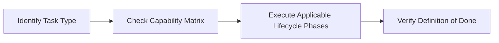

# Engineering Playbook & Development Standards Index

> **Welcome to the Reusable Engineering Playbook!**  
> This directory (`docs/development/`) provides a comprehensive, phase-based engineering standard designed for AI agents (Antigravity, Cursor, Windsurf, Claude Code) and human engineers alike.  
> It governs all software tasks: new features, bug investigations, refactoring, security reviews, test-driven development, builds, and production deployments.

---

## 1. Quick-Start Guide: How to Use This Playbook

Whenever you begin a software engineering task in this workspace, follow this 4-step sequence:



1. **Identify Your Task Type & Risk Tier**: Consult the [Task Selection Decision Matrix](#2-task-selection-decision-matrix).
2. **Review Applicable Phases**: Jump to the corresponding lifecycle phases in [DEVELOPMENT_LIFECYCLE.md](./DEVELOPMENT_LIFECYCLE.md).
3. **Copy the Verified Agent Prompt**: Grab the ready-to-run prompt from [13_ECC_AGENT_PROMPTS.md](./13_ECC_AGENT_PROMPTS.md).
4. **Gate with the Definition of Done**: Confirm every item in [15_DEFINITION_OF_DONE.md](./15_DEFINITION_OF_DONE.md) before declaring completion.

---

## 2. Task Selection Decision Matrix

Never execute every phase blindly for every task. Select the minimal, high-leverage path based on task type and risk level:

| Task Type | Risk Level | Required Lifecycle Phases | Core Guide & Workflow | Key ECC Agents & Tools |
|---|---|---|---|---|
| **New Feature (End-to-End)** | High / Critical | Phases 1–17 | [11_FEATURE_DEVELOPMENT_WORKFLOW.md](./11_FEATURE_DEVELOPMENT_WORKFLOW.md) | `architect`, `planner`, `tdd-guide`, `code-reviewer` |
| **Bug Fix / Defect** | Medium / High | Phases 1, 2, 4, 7, 8, 9, 10, 12, 13, 17 | [10_BUG_FIX_WORKFLOW.md](./10_BUG_FIX_WORKFLOW.md) | `silent-failure-hunter`, `tdd-guide`, `code-reviewer` |
| **Behavior-Preserving Refactor**| Medium | Phases 1, 4, 7, 8, 9, 10, 11, 12, 13 | [05_CODE_REVIEW_AND_REFACTORING.md](./05_CODE_REVIEW_AND_REFACTORING.md) | `refactor-cleaner`, `code-simplifier`, `code-reviewer` |
| **Security Audit / Remediation** | Critical | Phases 1, 4, 5, 6, 8, 9, 10, 12, 13 | [06_SECURITY_AND_DEPENDENCIES.md](./06_SECURITY_AND_DEPENDENCIES.md) | `security-reviewer`, `/security-scan` |
| **Build & Typecheck Fix** | Low / Medium | Phases 1, 8, 9, 12 | [07_BUILD_AND_VALIDATION.md](./07_BUILD_AND_VALIDATION.md) | `build-error-resolver`, `react-build-resolver`, `java-build-resolver` |
| **Testing & Coverage Expansion** | Low / Medium | Phases 1, 7, 9, 12, 13 | [04_TESTING_AND_TDD.md](./04_TESTING_AND_TDD.md) | `tdd-guide`, `/test-coverage` |
| **Documentation & Architecture Sync**| Low | Phases 1, 14, 17 | [12_DOCUMENTATION_MAINTENANCE.md](./12_DOCUMENTATION_MAINTENANCE.md) | `doc-updater`, `/update-docs` |
| **Release & Deployment** | Critical | Phases 1, 12, 13, 14, 15, 16, 17 | [09_RELEASE_AND_DEPLOYMENT.md](./09_RELEASE_AND_DEPLOYMENT.md) | `production-audit`, `delivery-gate` |

---

## 3. Verified vs. Optional ECC Capabilities

This repository contains an installed Everything Claude Code (ECC) configuration in [.agents/](../../.agents/). Below is the verified, empirical breakdown of capabilities present in this workspace:

### A. Verified Locally Installed Capabilities

These resources exist directly in [.agents/](../../.agents/) and are supported by the installed Antigravity environment:

* **Specialized Agent Personas** (68 definitions in [.agents/agents/](../../.agents/agents/)):
  * Persona instruction files providing targeted expert perspectives (e.g., `architect`, `planner`, `tdd-guide`, `code-reviewer`, `security-reviewer`, `react-reviewer`, `java-reviewer`, `build-error-resolver`).
  * *Execution Model*: These are markdown persona instructions used to steer the agent or pair-programmer; they are not background daemon processes or isolated sub-agent runtimes.
* **Specialized Skills** (48 skill directories in [.agents/skills/](../../.agents/skills/)):
  * On-demand instruction folders loaded when relevant (e.g., `tdd-workflow`, `verification-loop`, `error-handling`, `git-workflow`, `production-audit`, `architecture-decision-records`, `browser-qa`, `unified-memory`, `click-path-audit`, `e2e-testing`, `eval-harness`, `codebase-onboarding`, `agent-self-evaluation`).
  * *Structure*: Each contains a `SKILL.md` instruction file with optional scripts or references.
* **Standard Operating Workflows** (94 SOP guides in [.agents/workflows/](../../.agents/workflows/)):
  * Granular, step-by-step markdown operating procedures covering planning, TDD, reviews, builds, and releases.
  * *Important Distinction*: These markdown files are **guidance documents** to be opened and executed by the engineer or agent. They are **not** compiled binary executables or CLI scripts unless explicitly backed by a script in `scripts/`.
* **Native Antigravity Slash Commands**:
  * The installed Antigravity IDE natively exposes specific conversational slash commands:
    * `/plan`: Launch step-by-step implementation planning.
    * `/goal`: Run long-running autonomous execution toward a specific goal.
    * `/schedule`: Schedule one-shot timers or recurring cron triggers.
    * `/grill-me`: Interactive interview to resolve design decisions.
    * `/learn`: Extract and persist reusable session patterns.
* **Coding & Design Rules** (122 rule sets in [.agents/rules/](../../.agents/rules/)):
  * Common: `common-coding-style.md`, `common-development-workflow.md`, `common-git-workflow.md`, `common-code-review.md`, `common-testing.md`, `common-security.md`, `common-performance.md`.
  * Stack Specific: React, React Native, TypeScript, Java, Web design quality, and more.
  * *Location Rule*: Workspace customizations reside in `.agents/`. Do not rename `.agents/` to `.agent/`.

### B. Optional / Externally Dependent Capabilities

These capabilities require external API keys, MCP servers, or optional services:

* **CodeScene Code Health MCP (`codehealth-mcp`)**: Requires an active CodeScene MCP server connection and account.
* **Jira Integration (`jira`)**: Requires Atlassian Jira API credentials and endpoint configuration.
* **External Web Search MCPs (Exa / Context7)**: Optional; fall back to internal code search or local tool commands.
* **Multi-model Adversarial Loops (`santa-loop`, `council-multi-model`)**: Requires multi-model CLI routing and API credentials.

---

## 4. Fundamental Invariants & Agent Autonomy Boundaries

All engineers and AI agents operating in this repository must adhere to strict autonomy and safety boundaries:

### A. Autonomous Operations (Allowed Without Prior Confirmation)
Agents may autonomously:
1. Inspect code, directory trees, configuration files, and documentation.
2. Make code and test edits strictly within the approved task scope.
3. Run local tests, builds, type-checkers, and linters.
4. Diagnose and fix build or test failures introduced by their own edits.
5. Report progress, verification evidence, and remaining limitations.

### B. Strict Human Approval Boundaries (Never Autonomous)
Agents must **stop and obtain explicit human approval** before:
1. **Public API & Contract Changes**: Altering REST endpoints, WebSocket event payloads, or shared TypeScript types.
2. **Architecture & Security Alterations**: Changing authentication schemes, CORS configurations, session lifecycles, or encryption mechanisms.
3. **Database Schema Alterations**: Running or applying schema migrations in production, or proposing irreversible DDL operations.
4. **Test & Warning Suppression**: Suppressing failing tests, commenting out assertions, or silencing compiler warnings just to achieve a green build.
5. **Git & Destructive Operations**: Committing, pushing, tagging, merging, or running destructive filesystem commands (`rm -rf`, `git reset --hard`, `DROP TABLE`).
6. **Deployments & Releases**: Triggering production or staging deployments, container publishing, or release distribution.
7. **Secrets Handling**: Exposing, copying, or printing real credentials, tokens, or private keys in logs, prompts, or documentation.

### C. Core Engineering Invariants
1. **Zero Secrets in Files or Logs**: Never print, commit, or persist real API keys, JWT secrets, passwords, or credentials.
2. **Database Migrations are Append-Only**: Never edit existing Flyway migrations in [backend/src/main/resources/db/migration/](../../backend/src/main/resources/db/migration/). Always create a new `V<N>__<name>.sql`.
3. **Shared Types are the Single Source of Truth**: Data contracts between backend, web, and mobile must be declared in [packages/shared-types/src/index.ts](../../packages/shared-types/src/index.ts).
4. **No Destructive Commands Without Approval**: Never execute `rm -rf`, `DROP TABLE`, `git reset --hard`, or irreversible data modifications without explicit approval.
5. **No Hallucinated Passes**: Never claim tests or build checks passed without executing the command and inspecting the output.
6. **Preserve Existing Behavior**: Do not modify unrelated code, change public APIs silently, or break backward compatibility.

---

## 5. Universal Standards vs. Project-Specific Context

To ensure adaptability across different software projects:
* **Universal Standards (Chapters 1–15)**: Lifecycle phases, planning disciplines, TDD principles, code review standards, security threat modeling, and definition of done apply as foundational principles across ecosystems. Stack-specific code snippets (e.g. Maven, Vite, React Native) are provided as conditional reference implementations; repository-specific configurations and commands should be inspected in [PROJECT_CONTEXT.md](./PROJECT_CONTEXT.md).
* **Project-Specific Context ([PROJECT_CONTEXT.md](./PROJECT_CONTEXT.md))**: Contains verified information specific to this repository (IndiChat), including active ports (PostgreSQL 5554, Redis 6379, MinIO 9000/9001, Backend 8080, Vite 5174), package scripts, technology versions (Java 21, Spring Boot 3.3.5, React 18/19, Expo 57), and repository invariants.
* **Portability Template ([16_PROJECT_CONTEXT_TEMPLATE.md](./16_PROJECT_CONTEXT_TEMPLATE.md))**: Guide for adapting this playbook to any new repository.

---

## 6. Playbook Documentation Index

This playbook is split into modular, deep-dive chapters:

| Document | Purpose & Contents |
|---|---|
| [DEVELOPMENT_LIFECYCLE.md](./DEVELOPMENT_LIFECYCLE.md) | **Core**: The complete 17-phase lifecycle, exit criteria, and phase quality gates. |
| [01_DISCOVERY_AND_REQUIREMENTS.md](./01_DISCOVERY_AND_REQUIREMENTS.md) | Phase 1 & 2: Stack discovery, codebase inspection, requirement clarification, acceptance criteria. |
| [02_PLANNING_AND_DESIGN.md](./02_PLANNING_AND_DESIGN.md) | Phase 4, 5 & 6: Architecture review, data modeling, API contracts, risk assessment, plan approval. |
| [03_IMPLEMENTATION.md](./03_IMPLEMENTATION.md) | Phase 8: Clean code standards, SOLID principles, modularity, error handling, defensive logging. |
| [04_TESTING_AND_TDD.md](./04_TESTING_AND_TDD.md) | Phase 7 & 9: Testing pyramid, TDD workflow, AAA pattern, test failure diagnosis across stacks. |
| [05_CODE_REVIEW_AND_REFACTORING.md](./05_CODE_REVIEW_AND_REFACTORING.md) | Phase 10 & 11: Diff inspection, defect detection, severity levels, safe behavior-preserving refactoring. |
| [06_SECURITY_AND_DEPENDENCIES.md](./06_SECURITY_AND_DEPENDENCIES.md) | Threat modeling, secrets management, input sanitization, JWT auth, dependency auditing. |
| [07_BUILD_AND_VALIDATION.md](./07_BUILD_AND_VALIDATION.md) | Phase 12: Build pipelines, type-checkers, linters, static analysis, build troubleshooting. |
| [08_IMPLEMENTATION_VERIFICATION.md](./08_IMPLEMENTATION_VERIFICATION.md) | Phase 13: Evidence-based acceptance testing, browser verification, WebSocket protocol testing. |
| [09_RELEASE_AND_DEPLOYMENT.md](./09_RELEASE_AND_DEPLOYMENT.md) | Phase 15 & 16: Packaging, APK/deb builds, environment configuration, migration safety, rollback. |
| [10_BUG_FIX_WORKFLOW.md](./10_BUG_FIX_WORKFLOW.md) | Specialized pipeline: Reproduction, 5-Whys root cause analysis, regression test, minimal fix. |
| [11_FEATURE_DEVELOPMENT_WORKFLOW.md](./11_FEATURE_DEVELOPMENT_WORKFLOW.md) | Specialized pipeline: Full feature development across shared contracts, backend, web, and mobile. |
| [12_DOCUMENTATION_MAINTENANCE.md](./12_DOCUMENTATION_MAINTENANCE.md) | Phase 14: Keeping architecture docs, API contracts, READMEs, and changelogs synchronized. |
| [13_ECC_AGENT_PROMPTS.md](./13_ECC_AGENT_PROMPTS.md) | **Library**: 20 copy-and-paste prompts for master workflow and individual phases. |
| [14_TASK_TEMPLATES.md](./14_TASK_TEMPLATES.md) | **Templates**: Reusable templates for features, bug reports, refactoring, technical debt, releases. |
| [15_DEFINITION_OF_DONE.md](./15_DEFINITION_OF_DONE.md) | **Checklist**: 7-level completion gate required before closing any task or pull request. |
| [16_PROJECT_CONTEXT_TEMPLATE.md](./16_PROJECT_CONTEXT_TEMPLATE.md) | **Portability**: Guide for porting this entire playbook to other tech stacks and repositories. |
| [PROJECT_CONTEXT.md](./PROJECT_CONTEXT.md) | **Operating Context**: Active ports, build commands, and repository profile for IndiChat. |

---

## 7. Recommended Agent Integration (AGENTS.md / Instructions)

To ensure any AI agent automatically references this playbook during non-trivial tasks, add the following snippet to [AGENTS.md](../../AGENTS.md) or your system prompt:

```markdown
## Development Playbook & Engineering Standards
For all non-trivial engineering tasks (features, bug fixes, refactoring, code review, builds, releases), follow the standards and phase gates defined in:
`docs/development/README.md`
`docs/development/DEVELOPMENT_LIFECYCLE.md`
`docs/development/15_DEFINITION_OF_DONE.md`
```
