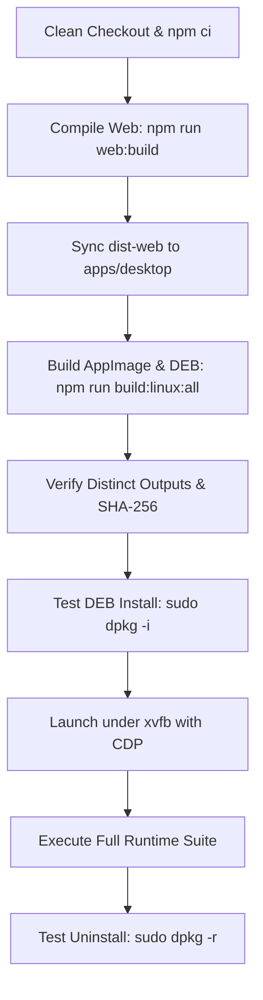
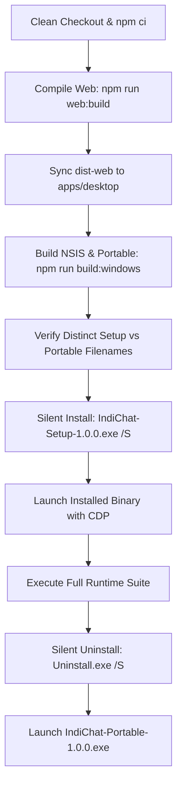

# Desktop Multi-Platform Release Verification Plan (Windows, Linux, macOS)

> **Status**: Local Reviewable Specification (Draft CI Plan)  
> **Rule**: Kept locally for review. Do not configure or trigger external CI, upload artifacts, or publish without explicit authorization.

---

## 1. Core Principles & Verification Invariants

1. **Clean Checkout & Deterministic Dependency Installation**:
   * CI runners must start from a clean checkout of the repository at the target release tag or commit.
   * Dependencies must be installed using the strict repository lockfile via `npm ci` (never `npm install`).
2. **Deterministic Production Asset Bundling**:
   * Prior to invoking `electron-builder`, the web client must be compiled for production (`npm run web:build`).
   * The compiled bundle in `apps/web/dist` must be synchronized into `apps/desktop/dist-web` to ensure that standalone executables contain the required web distribution assets inside `app.asar`.
3. **Distinct Installer and Portable Filenames**:
   * Windows packaging targets must never share filename templates.
   * NSIS Installer output: `IndiChat-Setup-${version}.exe` (e.g. `IndiChat-Setup-1.0.0.exe`).
   * Portable output: `IndiChat-Portable-${version}.exe` (e.g. `IndiChat-Portable-1.0.0.exe`).
   * Linux AppImage: `IndiChat-${version}.AppImage`.
   * Linux Debian: `indichat_${version}_${arch}.deb`.
   * macOS DMG: `IndiChat-${version}-${arch}.dmg`.
   * macOS ZIP: `IndiChat-${version}-${arch}.zip`.
4. **Genuine Application Runtime Testing**:
   * File existence checks and `--version` CLI flags **do not qualify as application runtime verification**.
   * On every target platform, the actual packaged application binary must be installed or launched in a real or headless display environment (`xvfb-run` on Linux, headless display on Windows/macOS).
   * Runtime verification must execute a full interaction journey: packaged-app startup, embedded proxy verification, login, messaging, real-time reactions, settings persistence, window controls, tray behavior, quit/relaunch, and uninstallation.
5. **Strict Test Environment Isolation**:
   * Tests must run against isolated backend instances (e.g. port `8199`) using fresh disposable databases.
   * Disposable test accounts must be registered dynamically (e.g. `ci_alice`, `ci_bob`) and never connected to existing production databases.
6. **Strict Separation of Signing and Runtime Gates**:
   * Package compilation, code signing, and native runtime execution must be tracked as distinct gates in verification reports. Unsigned or ad-hoc builds may clear functional runtime verification while remaining blocked for public distribution pending production signing certificates.

---

## 2. Multi-Platform Execution Workflows

### A. Linux Packaging & Native Runtime Verification (Ubuntu 22.04 Runner)



#### Linux Step-by-Step Procedure:
1. **Clean Installation & Build**:
   ```bash
   npm ci
   npm run web:build
   node scripts/build-linux.js --all
   ```
2. **Artifact Filename & Checksum Verification**:
   Verify the presence of distinct binary files in `release/linux/<build-id>/`:
   * `release/linux/<build-id>/IndiChat-1.0.0.AppImage`
   * `release/linux/<build-id>/indichat_1.0.0_amd64.deb`
   * Generate and record SHA-256 checksums and file sizes.
3. **Native Installation Test**:
   ```bash
   sudo dpkg -i release/linux/<build-id>/indichat_1.0.0_amd64.deb || sudo apt-get install -f -y
   which indichat
   ```
4. **Packaged Runtime Testing (Headless Display)**:
   Launch the installed binary under `xvfb` with remote debugging enabled:
   ```bash
   xvfb-run --auto-servernum --server-args="-screen 0 1440x900x24" \
     indichat --remote-debugging-port=9444 --user-data-dir=/tmp/ci-indichat-linux
   ```
   Execute automated CDP test harness verifying:
   * Embedded proxy server binding and serving bundled assets.
   * Authentication of disposable account against isolated backend.
   * Real-time message submission and reaction rendering.
   * IPC URL sanitization and sender frame validation.
   * Light/Dark theme switching.
   * Full process termination (`SIGTERM`) and relaunch session restoration.
5. **Uninstall Verification**:
   ```bash
   sudo dpkg -r indichat
   test ! -f /usr/bin/indichat
   # Verify user data retention policy (preserves ~/.config/IndiChat)
   test -d $HOME/.config/IndiChat
   ```

---

### B. Windows Packaging & Native Runtime Verification (Windows Server 2022 Runner)



#### Windows Step-by-Step Procedure:
1. **Clean Installation & Build**:
   ```powershell
   npm ci
   npm run web:build
   node scripts/build-windows.js
   ```
2. **Artifact Filename & Collision Check**:
   Confirm distinct outputs in `release/windows/`:
   * `release/windows/<build-id>/IndiChat-Setup-1.0.0.exe` (NSIS Installer)
   * `release/windows/<build-id>/IndiChat-Portable-1.0.0.exe` (Standalone Portable)
   * Verify file sizes and SHA-256 hashes via `Get-FileHash`.
3. **Silent Installation Test**:
   ```powershell
   $InstallDir = "C:\Program Files\IndiChat"
   Start-Process -FilePath "release\windows\<build-id>\IndiChat-Setup-1.0.0.exe" -ArgumentList "/S /D=$InstallDir" -Wait
   Test-Path "$InstallDir\indichat.exe"
   ```
4. **Packaged Runtime Testing**:
   Launch installed executable with remote debugging enabled:
   ```powershell
   $UserData = "$env:TEMP\ci-indichat-userdata"
   $AppProc = Start-Process -FilePath "$InstallDir\indichat.exe" `
     -ArgumentList "--remote-debugging-port=9444 --user-data-dir=$UserData" `
     -PassThru
   ```
   Execute automated CDP test harness verifying:
   * Startup, window title, embedded proxy routing.
   * Disposable account login and multi-device session binding.
   * In-chat message transmission and real-time reaction pills.
   * Server URL persistence across full process termination (`Stop-Process`) and relaunch.
   * IPC security, sender frame isolation, and URL protocol checks.
   * Theme switching and UI rendering.
5. **Silent Uninstallation & Data Retention Test**:
   ```powershell
   Start-Process -FilePath "$InstallDir\Uninstall.exe" -ArgumentList "/S" -Wait
   # Confirm executable removed
   !(Test-Path "$InstallDir\indichat.exe")
   # Confirm user data preserved per policy in %APPDATA%\IndiChat
   Test-Path "$env:APPDATA\IndiChat"
   ```
6. **Portable Runtime Verification**:
   Launch `release\windows\<build-id>\IndiChat-Portable-1.0.0.exe` directly, confirm clean standalone startup without prior installation.

---

### C. macOS Packaging & Native Runtime Verification (Darwin Runner)

*(Provisionally verified locally on macOS arm64; proposed for macOS CI runner)*:
1. **Clean Installation & Build**:
   ```bash
   npm ci
   npm run web:build
   node scripts/build-macos.js
   ```
2. **Artifact Filename & Verification**:
   * `release/macos/IndiChat-1.0.0-arm64.dmg`
   * `release/macos/IndiChat-1.0.0-arm64.zip`
3. **Installer Volume & Runtime Verification**:
   * Attach DMG via `hdiutil attach`, verify APFS volume integrity and drag-and-drop symlink.
   * Execute [`scripts/test-packaged-macos-native.cjs`](../../scripts/test-packaged-macos-native.cjs) against the standalone `.app` bundle (17/17 checks).
4. **Signing & Notarization Audit**:
   * Check signature with `codesign -dvvv`.
   * Check Gatekeeper acceptance with `spctl --assess --type execute`.
   * Gate: Passed for local ad-hoc runtime; pending Developer ID certificate and Apple Notarization for public distribution.

---

## 3. Reference GitHub Actions Specification (Local Review Only)

No remote workflow is configured or triggered by this plan. A platform-native
packaged application journey must be implemented before marking runtime verification
complete. The macOS-specific runner must not be invoked as a Windows/Linux test.

Build on a clean checkout with `npm ci`, then invoke `node scripts/build-windows.js`
or `node scripts/build-linux.js --all`. Each invocation uses a unique build output
and `release/<platform>/<build-id>/` directory. Read `manifest.json` in that directory
for actual package paths, byte sizes, and SHA-256 hashes. An absent requested target
fails the build; old packages are never counted as outputs of a new build.
The manifest deliberately sets `nativeRuntimeVerified: false`: successful packaging
alone cannot establish native startup, sandboxing, install/uninstall, tray behavior,
or messaging correctness. Those require separate platform-native evidence.

Run without sandbox-disabling switches. Use isolated user data and disposable test
services. Keep external CI setup, artifact uploads, and signing credentials outside
this local plan until explicitly authorized.

---

## 4. Summary of Verification Gates & Status

Current evidence: [Phase 3 local verification](phase-3-local-verification.md).

| Platform | Packaging | Local runtime evidence | External gates |
|---|---|---|---|
| macOS ARM64 | Prior sandboxed DMG/ZIP preserved | Previous macOS native verification reused | Distribution signing/notarization |
| Windows x64 | Unsigned NSIS and portable built; static/payload checks passed | Native Windows execution unavailable | Native install/runtime/uninstall and signing |
| Linux x64 | AppImage and Debian built; install/uninstall/content checks passed | 19/19 GUI smoke checks in Docker/Rosetta/Xvfb | Physical Linux/tray and direct AppImage/FUSE verification |

The user confirmed no native test hosts or signing credentials are available and
requested that external blockers be reported after local work is finished.

## Local container build alternative

On a host with Docker and installed workspace dependencies, run
`bash scripts/build-linux-container.sh`. The pinned Linux x64 builder reads the
source and dependency tree read-only, builds from a temporary container directory,
and writes only to a new build directory. It packages AppImage and Debian outputs
and publishes a local manifest only after both are present. This is cross-platform
packaging under emulation on Apple Silicon, not native Linux desktop verification.
The container does not start or alter review databases or application services.

Windows unsigned cross-builds are available through
`bash scripts/build-windows-container.sh`. Optional `INDICHAT_ELECTRON_DIST`
selects a cached runtime directory; archives are verified against the installed
Electron release manifest. Optional `INDICHAT_BUILDER_CACHE` provides read-only
cached NSIS tools, copied into the container to avoid repeated downloads.
The Windows compatibility path is explicitly unsigned and guarded to
`electron-builder` 25.1.8; see the current report before upgrading dependencies.
